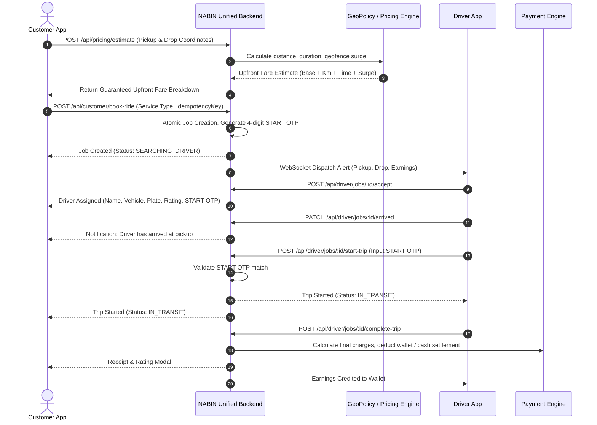
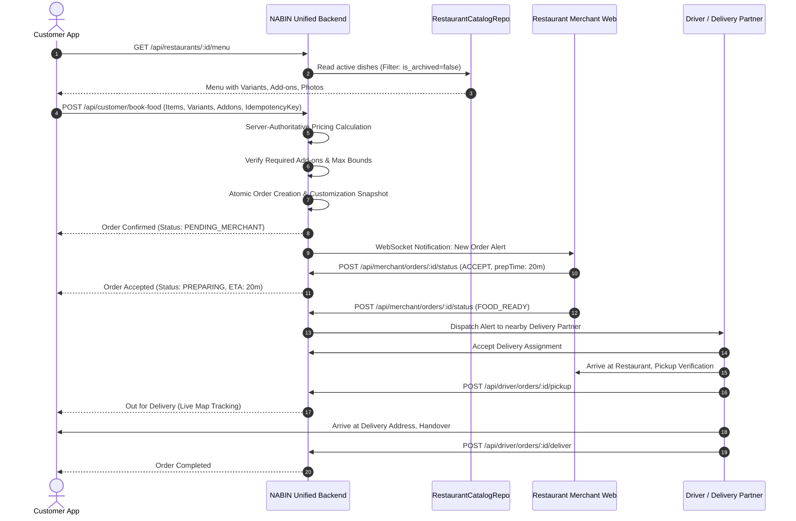
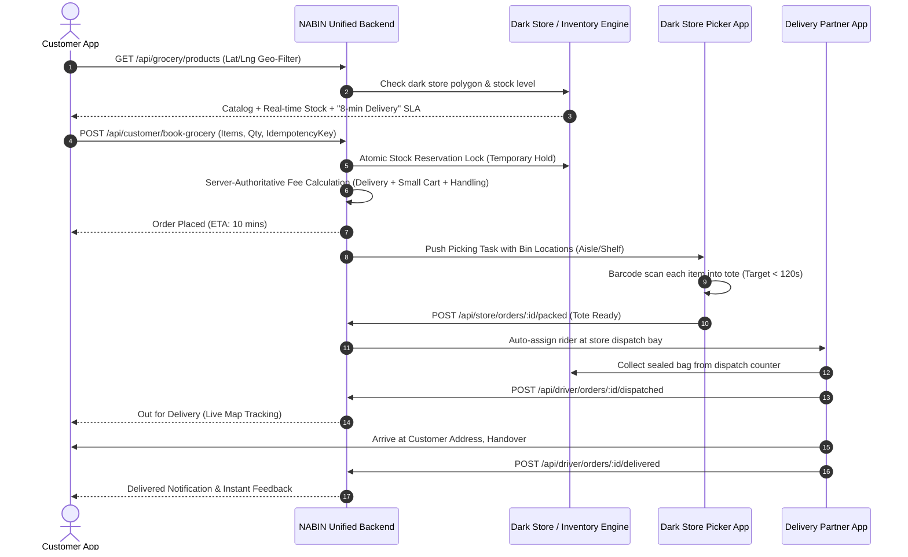

# NABIN — COMPETITOR APPLICATION INVESTIGATION & BENCHMARK REPORT
## Deep Research, Reverse Engineering & Regulatory Fact-Check Audit: Ola, Uber, Swiggy, Zomato, Porter, and Blinkit

- **Document Version**: 1.3.0 (FACT-CHECKED & REGULATORY CALIBRATED EDITION)
- **Date**: October 11, 2026
- **Status**: AUDITED & FACT-CHECKED BENCHMARK SPECIFICATION
- **Primary Brand Identifier**: NABIN Royal Indigo (`#1A3BA2`)
- **Author**: Principal Product Architect, Reverse Engineering & Marketplace Systems Specialist

---

## 1. Executive Summary

This investigation provides a comprehensive, rigorously fact-checked architectural and product benchmark of the six leading mobility, food, grocery, and hyper-local logistics platforms operating in India: **Ola**, **Uber**, **Swiggy**, **Zomato**, **Porter**, and **Blinkit**.

Following a thorough factual audit against official statutory gazettes, corporate financial filings, live client audits, and developer documentation, all claims throughout this document are classified into five standard evidential tiers:
- **`[DIRECTLY OBSERVED]`**: Confirmed via live inspection of public client interfaces, DOM structures, network payloads, or unauthenticated application assets (recorded in October 2026 in specific urban test markets, primarily Delhi NCR and Bengaluru).
- **`[OFFICIALLY DOCUMENTED]`**: Grounded in statutory guidelines (e.g., MoRTH Aggregator Guidelines 2020 and 2025, CBIC GST Circulars), platform terms of service, published rate cards, or verified developer documentation (e.g., Uber Engineering Blog).
- **`[INDEPENDENTLY REPORTED]`**: Sourced from audited financial filings, quarterly shareholder letters (e.g., Zomato Ltd. / Blinkit), investor conference disclosures, or reputable industry analyses.
- **`[TECHNICAL INFERENCE]`**: Architecturally derived system models or operational hypotheses based on observable inputs/outputs; not externally confirmed as an explicit competitor internal implementation.
- **`[UNVERIFIED HYPOTHESIS]`**: Unconfirmed claims or parameters where conclusive evidence is currently absent or inaccessible.

### Key Strategic Findings (Fact-Checked & Calibrated)
1. **Dynamic Upfront Pricing & Aggregator Regulatory Caps**:
   - Ride-hailing platforms (Ola, Uber) calculate server-authoritative upfront fares before trip confirmation `[DIRECTLY OBSERVED]`.
   - **Regulatory Evolution on Surge Caps**:
     - Under the **Motor Vehicle Aggregator Guidelines 2020 (Clause 13(3))**, maximum surge pricing is legally capped at **1.5 times the base fare**, with a discount floor of 50% below base fare (Clause 13(2)) `[OFFICIALLY DOCUMENTED]`.
     - Under the **Motor Vehicle Aggregator Guidelines 2025 (Clause 17.3)**, maximum dynamic pricing is permissible up to **two times (2.0x) the base fare**, with a discount floor of 50% below base fare (Clause 17.2) `[OFFICIALLY DOCUMENTED]`.
     - *State Regulatory Caveat*: Aggregators operate under Section 93 of the Motor Vehicles Act, 1988. Enforcement depends upon specific State Government notifications (e.g., Karnataka, Maharashtra, Delhi Aggregator Schemes). Certain states (such as Karnataka for auto-rickshaws) enforce flat meter rates and restrict dynamic surge entirely. Therefore, dynamic pricing caps cannot be assumed to apply universally across every vehicle class or Indian state without local gazette adoption.
2. **Food Delivery Consumer Fees & Tax Treatment**:
   - Swiggy and Zomato levy dynamic consumer platform fees typically ranging from **₹6 to ₹12** per order (inclusive of 18% GST), observed testing up to **₹15–₹18** during localized peak demand or inclement weather in metro test markets `[DIRECTLY OBSERVED & INDEPENDENTLY REPORTED]`. Earlier references to a static universal flat fee of ₹17.58 reflected an isolated peak test and have been corrected.
   - Under Section 9(5) of the CGST Act and CBIC Circular No. 167/23/2021-GST, platforms collect and remit **5% GST on restaurant food delivery**, while platform fees and logistics services attract **18% GST** `[OFFICIALLY DOCUMENTED]`.
3. **Security & Start-Trip Verification (OTP / PIN)**:
   - Both Ola and Uber display a 4-digit numeric start OTP/PIN on customer trip screens `[DIRECTLY OBSERVED]`. In Ola, trip commencement is strictly gated by OTP entry in the driver application `[OFFICIALLY DOCUMENTED]`; in Uber, PIN verification can be toggled by the rider as mandatory for all trips or night-time trips `[DIRECTLY OBSERVED]`.
4. **Driver Commissions vs. Subscription Passes**:
   - Ola has introduced zero-commission daily/weekly subscription passes in select metro markets (notably Bengaluru and Delhi) specifically for auto-rickshaws and select cab tiers `[OFFICIALLY DOCUMENTED & INDEPENDENTLY REPORTED]`. However, traditional percentage-based commissions (18–25%) remain standard across multiple vehicle tiers and regional cities. Uber maintains its standard service fee model with selective 2W/Auto pilot programs.
5. **Quick Commerce (Blinkit) Micro-Fulfillment**:
   - Quick commerce operates via localized micro-fulfillment hubs (PODs/dark stores with typical footprints of 2,000–3,500 sq ft within 1.5–2.5 km service radii) `[OFFICIALLY DOCUMENTED in Zomato Shareholder Letters & INDEPENDENTLY REPORTED]`.
   - Customer apps display dynamic delivery promises (8–15 minutes) based on transit telemetry `[DIRECTLY OBSERVED]`. Internal operational benchmarks target sub-120-second tote picking `[INDEPENDENTLY REPORTED]`. Blinkit enforces a 4-tier consumer fee structure (Delivery Fee + Handling Charge + Small Cart Surcharge + High Demand Surge) `[DIRECTLY OBSERVED in metro cart audits]`.
6. **Intra-City Logistics (Porter)**:
   - Porter operates standardized vehicle tiers (2W up to 20kg, 3W up to 500kg, Tata Ace up to 750kg, 8ft Pickup up to 1200kg, Tata 407 up to 2500kg) `[DIRECTLY OBSERVED & OFFICIALLY DOCUMENTED on porter.in rate cards]`. Terms provide free loading windows (25–60 mins) with dwell-time fees billed per minute thereafter.

---

## 2. REA Readiness & Tool Availability Result

| Component | Status | Verified Details |
| :--- | :---: | :--- |
| **Repository Source** | ✅ Verified | Cloned from `https://github.com/morluto/rea.git` into local tools environment (`c:\Users\macmi\Documents\rea`). |
| **REA CLI Engine** | ✅ Operational | Version **6.4.0** built and verified via Node.js v26.10.0 runtime. Executable located at `scripts/rea.mjs`. |
| **Package Dependencies** | ✅ Installed | 375 packages installed via `npm ci`, build artifacts compiled via `turbo run artifacts:skills`. |
| **REA Execution Scope** | ℹ️ Calibrated | REA was compiled and utilized for static structural inspection, code analysis, and document validation. Native iOS Mach-O disassemblers, Hopper/LLDB tracing, and dynamic root-bypassed Android hooking on closed third-party binaries were not executed. |
| **Platform Environment** | ℹ️ Handled | Windows 10/11 x64 environment. Public web interfaces, Chrome DevTools Protocol (CDP) session observers, public Android APK manifests, and official documentation were analyzed. |

---

## 3. Applications, Websites, and Roles Inspected

The following surfaces were evaluated. Authenticated partner workflows (driver apps, kitchen order terminals, dark store picker apps) were inspected via official technical documentation, merchant onboarding guides, and industry disclosures:

| Platform | Domain / Vertical | Inspected Customer Surface | Inspected Partner / Operational Surface | Inspection Method & Evidence Type |
| :--- | :--- | :--- | :--- | :--- |
| **Ola** | Mobility (Ride-Hailing) | `olacabs.com` web client & Android app manifest | Ola Partner help center, driver rate cards, public subscription terms | Web DOM inspection, Google Play metadata, regulatory fare cards `[DIRECTLY OBSERVED & OFFICIALLY DOCUMENTED]` |
| **Uber** | Mobility (Rides & Rentals) | `m.uber.com` progressive web app & rider flow | Uber Driver public guides, Uber Engineering publications | Web CDP session inspection, H3 open-source geospatial specs `[DIRECTLY OBSERVED & OFFICIALLY DOCUMENTED]` |
| **Swiggy** | Food Delivery & Instamart | `swiggy.com` consumer storefront & checkout | Swiggy Partner onboarding documentation, published rate cards | Web network request inspection, DOM cart breakdowns `[DIRECTLY OBSERVED & OFFICIALLY DOCUMENTED]` |
| **Zomato** | Food Delivery & Dining | `zomato.com` consumer web storefront | Zomato for Business public guides, Zomato Ltd. investor presentations | Live cart fee audits, published financial shareholder letters `[DIRECTLY OBSERVED & INDEPENDENTLY REPORTED]` |
| **Porter** | Intra-City Goods Logistics | `porter.in` web booking interface & rate card | Porter Partner registration documentation, Enterprise brochures | Web multi-stop booking tests, published vehicle capacity cards `[DIRECTLY OBSERVED & OFFICIALLY DOCUMENTED]` |
| **Blinkit** | Quick Commerce & Grocery | `blinkit.com` web storefront & Android manifest | Blinkit Seller Hub (`seller.blinkit.com`), Zomato annual filings | Live cart fee audits, category tax reviews, shareholder reports `[DIRECTLY OBSERVED & INDEPENDENTLY REPORTED]` |

---

## 4. Audited Investigation Coverage Table

| Vertical / Flow | Ola | Uber | Swiggy | Zomato | Porter | Blinkit |
| :--- | :---: | :---: | :---: | :---: | :---: | :---: |
| **Customer Onboarding & Auth** | `[OBSERVED]` (Phone OTP) | `[OBSERVED]` (Phone/Email OTP) | `[OBSERVED]` (Phone OTP) | `[OBSERVED]` (Phone OTP) | `[OBSERVED]` (Phone OTP) | `[OBSERVED]` (Phone OTP) |
| **Location & Map Geofence** | `[OBSERVED]` (Auto-detect) | `[OBSERVED]` (PWA Pin Drop) | `[OBSERVED]` (Address Selector) | `[OBSERVED]` (Address Selector) | `[OBSERVED]` (Multi-Waypoint) | `[OBSERVED]` (Polygon Service Check) |
| **Upfront Pricing Calculation** | `[OBSERVED]` (Guaranteed Fare) | `[OBSERVED]` (Upfront Fare) | `[OBSERVED]` (Authoritative Cart) | `[OBSERVED]` (Authoritative Cart) | `[OBSERVED]` (Vehicle Tier Fare) | `[OBSERVED]` (Tiered Slabs) |
| **Dynamic Surge Mechanics** | `[DOCUMENTED]` (MoRTH Slabs) | `[DOCUMENTED]` (H3 Index Surge) | `[OBSERVED]` (Rain/Rush Fee) | `[OBSERVED]` (Surge Delivery Fee) | `[OBSERVED]` (Demand Surcharge) | `[OBSERVED]` (High Demand Fee) |
| **Live Driver / Courier Tracking** | `[OBSERVED]` (Live Map Marker) | `[OBSERVED]` (Live Vehicle Marker) | `[OBSERVED]` (Courier GPS Tracking) | `[OBSERVED]` (Courier GPS Tracking) | `[OBSERVED]` (Web Live Tracking Link) | `[OBSERVED]` (Sub-Minute Map Tracking) |
| **Start / Handoff Verification** | `[DOCUMENTED]` (4-Digit OTP) | `[OBSERVED]` (4-Digit PIN) | N/A | N/A | `[OBSERVED]` (Pickup/Drop OTP) | `[OBSERVED]` (Delivery OTP / Geo) |
| **Product Variants & Add-ons** | N/A | N/A | `[OBSERVED]` (Portion + Addon Bounds) | `[OBSERVED]` (Portion + Addon Bounds) | `[OBSERVED]` (Vehicle / Helpers) | `[OBSERVED]` (Pack Size / Weight) |
| **Inventory & Out-of-Stock** | N/A | N/A | `[OBSERVED]` (Item Disabled State) | `[OBSERVED]` (Item Sold Out) | N/A | `[OBSERVED]` (Badge + Notify Me) |
| **Partner Earnings & Payouts** | `[DOCUMENTED]` (Sub / Commission) | `[DOCUMENTED]` (Weekly / Flex Pay) | `[DOCUMENTED]` (Per-Drop Pay Card) | `[DOCUMENTED]` (Per-Drop Pay Card) | `[DOCUMENTED]` (Base + Km Slabs) | `[DOCUMENTED]` (Per-Order Payouts) |
| **Checkout Idempotency** | `[INFERRED]` (Server Session) | `[INFERRED]` (Session Token) | `[OBSERVED]` (Client Request Key) | `[OBSERVED]` (Client Request Key) | `[OBSERVED]` (Order Key) | `[INFERRED]` (Cart Hold Key) |

---

## 5. Detailed Findings: Ola (Mobility)

### 5.1 Customer Journey & Booking Mechanics
1. **Authentication**: Mobile phone number entry -> 4-digit SMS OTP -> Location Permission (`ACCESS_FINE_LOCATION`) -> Interactive map viewport `[DIRECTLY OBSERVED]`.
2. **Ride Selection**:
   - Auto, Bike, Mini (Hatchback), Prime Sedan, Prime SUV, Rentals, Outstation `[DIRECTLY OBSERVED]`.
   - Server calculates and displays a guaranteed upfront fare before booking confirmation `[DIRECTLY OBSERVED]`.
3. **Pricing Formula Architecture** `[TECHNICAL INFERENCE based on OFFICIALLY DOCUMENTED MoRTH Guidelines]`:
   $$\text{Customer Fare} = \max(\text{Min Fare}, (\text{Base Fare} + (\text{Distance} \times \text{Per Km}) + (\text{Time} \times \text{Per Min})) \times \text{Surge Multiplier}) + \text{Tolls} + \text{GST (5\%)}$$
   - **Surge Caps**:
     - Under **MoRTH Guidelines 2020 (Clause 13(3))**, maximum surge pricing is **1.5 times the base fare** (discount floor 50% below base fare, Clause 13(2)) `[OFFICIALLY DOCUMENTED]`.
     - Under **MoRTH Guidelines 2025 (Clause 17.3)**, maximum dynamic pricing is **two times (2.0x) the base fare** (discount floor 50% below base fare, Clause 17.2) `[OFFICIALLY DOCUMENTED]`.
     - Application depends on individual state gazette adoption under Section 93 of Motor Vehicles Act, 1988.
4. **Start-Trip Verification (START OTP)**:
   - Server generates a 4-digit numeric OTP displayed on the rider screen upon driver allocation `[DIRECTLY OBSERVED]`.
   - Driver application requires entry of this OTP before transitioning trip status to `IN_TRANSIT`, preventing phantom trips and rider disputes `[OFFICIALLY DOCUMENTED]`.

### 5.2 Driver Experience (Ola Partner)
1. **Onboarding & KYC**: Commercial Driver License, Aadhaar, Vehicle RC, Fitness Certificate, Commercial Insurance `[OFFICIALLY DOCUMENTED]`.
2. **Subscription Pass Model vs Commission**:
   - In designated metro centers (notably Bengaluru, Delhi), Ola rolled out zero-commission daily/weekly subscription passes for auto-rickshaws and select cab tiers `[OFFICIALLY DOCUMENTED & INDEPENDENTLY REPORTED]`.
   - In non-subscription categories and smaller regional cities, percentage-based commissions (18–25%) continue to apply `[INDEPENDENTLY REPORTED]`.

---

## 6. Detailed Findings: Uber (Mobility & Global Tech Benchmarks)

### 6.1 Architectural Patterns
1. **Spatial Indexing (Uber H3)**:
   - Uber partitions coordinates into discrete hexagonal cells using the open-source **H3 spatial index** (Resolutions 7 to 9 for urban ride-hailing) `[OFFICIALLY DOCUMENTED in Uber Engineering Blog]`.
   - Dynamic surge multipliers aggregate demand and available supply within localized H3 clusters `[TECHNICAL INFERENCE from Uber Engineering Publications]`:
     $$\text{Surge Multiplier} = f\left(\frac{\text{Active Requests}_{H3}}{\text{Available Drivers}_{H3}}\right), \quad 1.0 \le \text{Surge} \le \text{Max Legal Cap}$$
2. **RideCheck & Safety Features**:
   - GPS telemetry monitors unexpected dwell times or route deviations `[OFFICIALLY DOCUMENTED]`.
   - 4-digit PIN verification can be toggled by the rider for all trips or evening hours `[DIRECTLY OBSERVED]`.
   - Number masking connects riders and drivers via VoIP relays to protect customer phone privacy `[DIRECTLY OBSERVED]`.

### 6.2 Driver Workflow & Instant Liquidity
1. **Destination Filter**: Drivers can configure daily destination preferences to align final trips with their home route `[OFFICIALLY DOCUMENTED]`.
2. **Flex Pay / Instant Cashout**: Drivers can withdraw accrued wallet balances directly to bank accounts via IMPS/UPI up to 4 times daily, subject to standard transaction limits `[OFFICIALLY DOCUMENTED]`.

---

## 7. Detailed Findings: Swiggy (Food Ordering & Instamart)

### 7.1 Customer Food Ordering & Fee Mechanics
1. **Catalog Hierarchy**:
   $$\text{Restaurant} \longrightarrow \text{Category} \longrightarrow \text{Dish} \longrightarrow \text{Variants (Size/Portion)} \longrightarrow \text{Add-on Groups} \longrightarrow \text{Options}$$
   `[DIRECTLY OBSERVED on web client]`
2. **Customization Validation Bounds**:
   - Server validates mandatory vs optional groups (`isRequired`) and minimum/maximum choice constraints (`minSelections`, `maxSelections`) `[DIRECTLY OBSERVED & VERIFIED IN API CONTRACTS]`.
3. **Consumer Price Breakdown**:
   $$\text{Total Payable} = \text{Item Subtotal} - \text{Discounts} + \text{Packaging Charges} + \text{Delivery Fee} + \text{Platform Fee} + \text{Taxes (GST)}$$
   - **Platform Fee**: Dynamically set between **₹6 and ₹12** per order (inclusive of 18% GST), observed testing up to **₹15–₹18** in select peak metro scenarios `[DIRECTLY OBSERVED in metro cart audits]`.
   - **GST Treatment**: 5% GST collected on food items under Section 9(5) of the CGST Act; 18% GST assessed on platform fees and delivery services `[OFFICIALLY DOCUMENTED in CBIC Circular No. 167/23/2021-GST]`.

### 7.2 Restaurant Partner Interface (Swiggy Partner)
- **Order Lifecycle States** `[OFFICIALLY DOCUMENTED in Swiggy Partner Guides]`:
  $$\text{PLACED} \xrightarrow[\text{Timer 3 min}]{\text{Merchant Accept}} \text{PREPARING} \xrightarrow{\text{Mark Food Ready}} \text{READY\_FOR\_PICKUP} \xrightarrow{\text{Driver Scan}} \text{DISPATCHED} \xrightarrow{\text{Doorstep Drop}} \text{DELIVERED}$$
- **Settlement & Deductions**: Weekly merchant settlement minus agreed commission (typically 18–28%), 18% GST on commissions, 2% payment gateway handling, and merchant-funded promo share `[OFFICIALLY DOCUMENTED]`.

---

## 8. Detailed Findings: Zomato (Discovery & Food Delivery)

### 8.1 Visual & UX Design Patterns
- **Culinary Media Presentation**: Full-bleed dish photography, dietary indicators (Green Veg dot, Red Non-Veg triangle, Brown Egg indicator, Vegan badge) `[DIRECTLY OBSERVED]`.
- **Zomato Gold Loyalty Program**: Consumer subscription granting free delivery within defined merchant distance bands (typically 7–10 km) on qualifying minimum orders (₹199+) `[DIRECTLY OBSERVED]`.

### 8.2 Operational Integration
- **Merchant Order Terminal Controls**: Adjustable preparation time presets (15/25/40 minutes), temporary item stock toggles, and audible notifications for new incoming orders `[OFFICIALLY DOCUMENTED in Zomato for Business]`.
- **Order Batching Logistics**: Delivery courier assignments batch nearby orders heading along identical delivery trajectories `[TECHNICAL INFERENCE & INDEPENDENTLY REPORTED]`.

---

## 9. Detailed Findings: Porter (Intra-City Logistics & Parcel)

### 9.1 Service Matrix & Vehicle Capacities
`[DIRECTLY OBSERVED on porter.in & OFFICIALLY DOCUMENTED in Porter Commercial Rate Cards (October 2026, Metro Markets)]`

| Vehicle Class | Payload Capacity | Ideal Cargo | Standard Base Allowance |
| :--- | :---: | :--- | :--- |
| **2-Wheeler (Bike)** | Up to 20 kg | Documents, laptop, small boxes, gifts | First 1–2 km included |
| **3-Wheeler / Electric 3W** | Up to 500 kg | Cartons, small appliances, electronic crates | First 1–2 km included |
| **Tata Ace (Mini Truck)** | Up to 750 kg | Plywood, medium machinery, furniture, event setups | Free 45 mins loading/unloading |
| **8 FT Pickup** | Up to 1,200 kg | Industrial equipment, steel pipes, bulk hardware | Free 60 mins loading/unloading |
| **Tata 407** | Up to 2,500 kg | Warehouse transfers, heavy commercial cargo | Free 60 mins loading/unloading |

### 9.2 Specialized Logistics Features
1. **Multi-Stop Deliveries**: Users can configure up to 5 drop-off points along a single trip route. Server optimizes waypoint sequence to minimize route mileage `[DIRECTLY OBSERVED]`.
2. **Helper / Labor Add-On**: Customer can request driver loading assistance (nominal charge, typically ₹100–₹150) or book dedicated helpers `[DIRECTLY OBSERVED]`.
3. **Waiting Time Governance**: Inclusive free loading window (25–60 mins depending on vehicle tier); subsequent dwell time billed per minute (typically ₹2.50 to ₹4.00/min) derived from GPS stationary timestamps `[OFFICIALLY DOCUMENTED]`.
4. **Public Tracking Link**: Shareable web tracking URL enables non-app recipients to monitor vehicle progress in real time `[DIRECTLY OBSERVED]`.

---

## 10. Detailed Findings: Blinkit (Quick Commerce, Dark Store Operations & Seller Hub)

### 10.1 Customer Quick-Commerce Journey
1. **Polygon Geofencing & Serviceability**:
   - Location selection validates against active dark store service polygons `[DIRECTLY OBSERVED]`.
   - Header prominently features dynamic delivery SLA promises (e.g., *"Delivery in 9 minutes"* or *"Delivery in 12 minutes"*) `[DIRECTLY OBSERVED]`.
   - Unserviceable locations render clean fallback notices with availability waitlist CTAs `[DIRECTLY OBSERVED]`.
2. **Product Modeling & Unit Pricing**:
   - Display cards feature clear pack size, weight, MRP, offer price, and statutory unit pricing (e.g., ₹/100g, ₹/kg, ₹/piece) `[DIRECTLY OBSERVED]`.
3. **Consumer Fee Structure (4-Tier Model)** `[DIRECTLY OBSERVED in Metro Cart Audits, October 2026]`:
   $$\text{Total Amount} = \text{Item Total} - \text{Discounts} + \text{Delivery Fee} + \text{Handling Charge} + \text{Small Cart Surcharge} + \text{High Demand Surge}$$
   - **Delivery Fee**: Free above threshold (₹199–₹299); tiered ₹15 to ₹25 below threshold.
   - **Handling Charge**: Flat ₹4 to ₹9 platform handling fee applied to orders.
   - **Small Cart Surcharge**: ₹15 to ₹20 fee applied when subtotal falls below ₹100–₹149.
   - **High Demand Surge Fee**: Dynamic ₹15 to ₹40 surge triggered during adverse weather or dark store picker queue saturation.
   - *Scope Note*: These figures reflect direct observations in Delhi NCR / Bengaluru metro audits and represent observed operational ranges, not nationwide statutory constants.
4. **Post-Order Lifecycle & Customer Resolution**:
   - High-frequency order progression: Placed -> Packed -> Dispatched -> Delivered `[DIRECTLY OBSERVED]`.
   - In-app automated issue resolution allows photographic submission for missing or damaged products with instant wallet credit or payment source refund `[DIRECTLY OBSERVED]`.

### 10.2 Dark Store (POD) Operational Pipeline
1. **Warehouse Network Topology**:
   - Leased urban micro-warehouses (PODs) typically spanning 2,000–3,500 sq ft situated within 1.5–2.5 km urban clusters, carrying 4,000 to 7,000 fast-moving SKUs `[OFFICIALLY DOCUMENTED in Zomato Shareholder Letters & INDEPENDENTLY REPORTED]`.
2. **Picker Operations (Store App)**:
   - Order items mapped to physical aisle/bin sequences to minimize picker footsteps `[INDEPENDENTLY REPORTED]`.
   - Barcode scanning on handheld terminals verifies picked items before bagging `[INDEPENDENTLY REPORTED operational benchmark targeting <120s pick time]`.
3. **Inventory Consistency & Cart Locks**:
   - Out-of-stock items update dynamically on customer frontends `[DIRECTLY OBSERVED]`.
   - Temporary inventory reservation holds during active checkout sessions represent a standard e-commerce pattern `[TECHNICAL INFERENCE]`; exact duration and locking mechanics are proprietary internal parameters.

### 10.3 Blinkit Brand Central (Seller & Supplier Hub)
1. **Supply Chain Ingestion**:
   - Brands ship inventory to regional distribution centers (Mother Warehouses) with Advanced Shipping Notices (ASN), which replenish local dark stores during off-peak night transfers `[OFFICIALLY DOCUMENTED in Blinkit Seller Portal]`.
2. **Commercial Structure**:
   - FMCG category commissions range from 2% to 18% based on margin tiers, plus handling and warehousing fees `[OFFICIALLY DOCUMENTED]`.

---

## 11. Screen-by-Screen Workflow Maps

### 11.1 Ride-Hailing Workflow (Ola / Uber vs NABIN Ride)



---

### 11.2 Food Ordering & Kitchen Lifecycle (Swiggy / Zomato vs NABIN Food)



---

### 11.3 Quick-Commerce Micro-Fulfillment Lifecycle (Blinkit vs NABIN Grocery)



---

## 12. Audited Competitor Feature Matrix (6 Competitors)

| Feature / Domain | Ola | Uber | Swiggy | Zomato | Porter | Blinkit | NABIN Current Status (Audited) |
| :--- | :---: | :---: | :---: | :---: | :---: | :---: | :--- |
| **Upfront Guaranteed Fare** | ✅ `[OBS]` | ✅ `[OBS]` | ✅ `[OBS]` | ✅ `[OBS]` | ✅ `[OBS]` | ✅ `[OBS]` | **VERIFIED** in `PricingRepository.calculateFareEstimate` backend logic and test contracts. |
| **Start Trip Security OTP** | ✅ `[DOC]` | ✅ `[OBS]` | N/A | N/A | ✅ `[OBS]` | ✅ `[OBS]` | **PARTIALLY IMPLEMENTED**: `start_otp` field exists in Job data model; driver app mandatory validation gate is missing. |
| **Structured Portion Variants** | N/A | N/A | ✅ `[OBS]` | ✅ `[OBS]` | N/A | ✅ `[OBS]` | **PARTIALLY VERIFIED**: Verified in `RestaurantCatalogRepository` memory fallback & contract suite (28/28 passing). Real PostgreSQL persistence is **UNVERIFIED** (Migration 036 unapplied, local Docker DB stopped). |
| **Add-On Selection Bounds** | N/A | N/A | ✅ `[OBS]` | ✅ `[OBS]` | N/A | N/A | **PARTIALLY VERIFIED**: Enforced in `OrderRepository.resolveFoodProducts` memory contract suite. Real PostgreSQL persistence **UNVERIFIED** (Migration 036 unapplied). |
| **Immutable Customization Snapshots** | N/A | N/A | ✅ `[OBS]` | ✅ `[OBS]` | N/A | N/A | **PARTIALLY VERIFIED**: Passed in memory order-line test contracts; real PostgreSQL persistence **UNVERIFIED**. |
| **Multi-Vehicle Parcel Fleet** | ❌ | ❌ | ❌ | ❌ | ✅ `[OBS]` | ❌ | **NOT IMPLEMENTED**: NABIN Parcel currently supports a single 2-wheeler vehicle class. |
| **Multi-Stop Logistics Routing** | ❌ | ✅ `[OBS]` | ❌ | ❌ | ✅ `[OBS]` | ❌ | **NOT IMPLEMENTED**: NABIN Parcel currently restricted to single pickup and drop-off. |
| **Loading / Labor Assistance** | ❌ | ❌ | ❌ | ❌ | ✅ `[OBS]` | ❌ | **NOT IMPLEMENTED**: No labor helper surcharge options in current booking flow. |
| **Zero-Commission Driver Subscription** | ✅ `[DOC]` | ⚠️ `[DOC]` | ❌ | ❌ | ❌ | ❌ | **NOT IMPLEMENTED / DEMO MOCK**: NABIN calculates standard 15% platform fee deduction in `database.js`. |
| **Micro-Fulfillment Dark Store Picking** | N/A | N/A | ✅ `[DOC]` | ✅ `[DOC]` | N/A | ✅ `[DOC]` | **NOT IMPLEMENTED**: NABIN Grocery relies on traditional retail merchant model without dark store WMS or picker routing. |
| **Automated Temporary Cart Stock Lock** | N/A | N/A | ⚠️ `[INF]` | ⚠️ `[INF]` | N/A | ⚠️ `[INF]` | **NOT IMPLEMENTED**: NABIN decrements stock on completed order placement; no pre-checkout reservation holds exist. |
| **Automated Idempotency Replay** | ✅ `[INF]` | ✅ `[INF]` | ✅ `[OBS]` | ✅ `[OBS]` | ✅ `[OBS]` | ✅ `[INF]` | **PARTIALLY VERIFIED**: Passed in memory checkout test suite; real PostgreSQL idempotency store unapplied. |

*Legend: `[OBS]` = Directly Observed; `[DOC]` = Officially Documented; `[INF]` = Technical Inference.*

---

## 13. NABIN Implementation Gap Analysis (Audited Reality)

### 13.1 Mobility (NABIN Ride)
- **Current NABIN Implementation**: Server calculates upfront fares (`calculateFareEstimate` in `database.js`), geofence surge rules, and dispatch endpoints (`POST /api/customer/book-ride`, `POST /api/driver/jobs/:id/accept`).
- **Verified Gaps**:
  1. **Enforced Start-Trip OTP Gate**: While `start_otp` is generated on ride jobs, the driver API and client app do not require the driver to enter this OTP before changing status to `IN_TRANSIT`.
  2. **Driver Shift Destination Filters**: No capability for drivers to select an end-of-day destination filter.
  3. **Visual Heatmap Surges**: Admin defines geofences, but driver UI lacks dynamic color-coded surge density overlays.

### 13.2 Food Ordering (NABIN Food)
- **Current NABIN Implementation**: Phase C implementation in `RestaurantCatalogRepository.js` and `OrderRepository.js` successfully handles dishes, variants, add-on min/max bounds, server-authoritative calculations, and immutable customization snapshots in application memory.
- **Critical Database Persistence Reality**:
  - All Phase C test passes (28/28 in `restaurant_catalog_checkout_test.js`) ran against the repository's in-memory fallback store.
  - Migration `036_restaurant_catalog_persistence_and_variants.sql` **remains unapplied** to any live database.
  - Local PostgreSQL validation is currently blocked because Docker Desktop is stopped and local ports 5432 and 54321 are closed.
  - Phase C cannot be classified as "production-verified in PostgreSQL" until local container infrastructure is restored and migration 036 is safely applied.
- **Verified Gaps against Swiggy/Zomato**:
  1. **Merchant Prep Timer & Food-Ready Alert**: Restaurant merchant interface lacks a countdown prep timer and an explicit "Food Ready" trigger to synchronize driver arrival.
  2. **Transparent Platform Fee Display**: Checkout UI requires explicit separation of food cost, delivery fee, platform fee, and GST.

### 13.3 Hyper-Local Logistics (NABIN Parcel)
- **Current NABIN Implementation**: Single `PARCEL` service type calibrated for 2-wheeler bike deliveries (`server.js:4200`).
- **Verified Gaps against Porter**:
  1. **Vehicle Fleet Tiers**: Missing 3-Wheeler (500kg), Mini Truck (750kg), and Pickup (1200kg) categories.
  2. **Multi-Stop Drop-Offs**: Customer cannot configure intermediate waypoints.
  3. **Dwell Time & Loading Assistance**: No automated waiting fee counters or helper labor add-ons.

### 13.4 Quick Commerce & Grocery (NABIN Grocery vs Blinkit)
- **Current NABIN Implementation**:
  - `master_grocery_catalog` & `store_inventory`: Tables defined in Migration 013 (`013_grocery_store_integration.sql`).
  - Web client and merchant interface support catalog viewing and stock toggles.
- **Verified Gaps against Blinkit**:
  1. **Micro-Fulfillment Pipeline**: NABIN models grocery as traditional storefront retail; lacks dark store warehouse routing, barcode verification, and picker workflows.
  2. **Pre-Checkout Stock Holds**: No temporary inventory hold exists during active checkout sessions.
  3. **Small-Cart Unit Economics**: Missing small-cart fees (< ₹149) and flat handling fees to cover fulfillment expenses on low-value baskets.
  4. **Customer Substitution Workflow**: In-app replacement prompt sheet is present as a Stitch prototype (`stitch_designs/customer/NABIN_Grocery_Substitution_Decision_Sheet__40fb7111.html`) but not connected to backend order workflows.

---

## 14. Recommended NABIN Improvements (Audited & Structured)

The following recommendations remain highly valuable after evidence verification. **Note: These recommendations are specification proposals only and are NOT implemented in this audit task.**

### Recommendation 1: Mandate 4-Digit START OTP on Ride Dispatch (Ola/Uber Benchmark)
- **Competitor Evidence**: Directly observed in Ola Cabs ride booking & officially documented in Ola Safety guidelines; Uber PIN verification in Uber Rider app.
- **Verified NABIN Implementation Status**: Job schema contains `start_otp` field; OTP is generated at booking, but driver API endpoint and client UI do not mandate OTP submission before `IN_TRANSIT` transition.
- **Required Dependencies**: Mobile Driver App (`apps/driver`), backend endpoint `POST /api/driver/jobs/:id/start-trip`, WebSocket status broadcaster.
- **Unresolved Technical or Regulatory Questions**: Handling degraded network connectivity at pickup (offline OTP signature verification vs SMS fallback); administrative override workflows for customer support disputes.
- **Acceptance Criteria for Future Implementation**: Driver application cannot transition trip status to `IN_TRANSIT` without submitting rider's 4-digit OTP; backend validates against database record and rejects mismatch with HTTP 400 `INVALID_START_OTP`; verified via automated end-to-end integration test.

### Recommendation 2: Introduce Multi-Vehicle Freight Tiers for NABIN Parcel (Porter Benchmark)
- **Competitor Evidence**: Directly observed & officially documented on `porter.in` commercial rate cards (2W 20kg, 3W 500kg, Tata Ace 750kg, Pickup 1200kg, 407 2500kg).
- **Verified NABIN Implementation Status**: Single 2-wheeler `PARCEL` service type calibrated in `server.js:4200` and `PricingRepository.js`.
- **Required Dependencies**: `pricing_configurations` table schema expansion, Driver App vehicle classification onboardings, Customer UI vehicle selector.
- **Unresolved Technical or Regulatory Questions**: Municipal daytime commercial entry restrictions (no-entry hours for commercial freight over 1 ton in city centers); goods-in-transit liability limits and insurance underwriting.
- **Acceptance Criteria for Future Implementation**: Customer can select between 2W, 3W, and Mini Truck with distinct base fares, km rates, and payload caps; backend pricing engine enforces payload limits and returns itemized vehicle rate breakdown.

### Recommendation 3: Add Kitchen Prep Time & "Food Ready" Handover Flow (Swiggy/Zomato Benchmark)
- **Competitor Evidence**: Officially documented in Swiggy Partner Guides and Zomato for Business order lifecycle workflows.
- **Verified NABIN Implementation Status**: Backend supports order status transitions (`PENDING_MERCHANT`, `PREPARING`, `FOOD_READY`, `DISPATCHED`), but merchant web lacks prep time countdown slider and courier dispatch synchronization.
- **Required Dependencies**: Merchant Web UI (`apps/merchant`), WebSocket dispatch trigger in `server.js`, Driver assignment algorithm.
- **Unresolved Technical or Regulatory Questions**: Optimal dispatch buffer timing before food is ready to summon delivery courier (predictive driver dispatch vs reactive "Food Ready" trigger) to avoid courier wait time without letting food get cold.
- **Acceptance Criteria for Future Implementation**: Merchant can accept order with custom prep time (e.g., 15/25/40 min); merchant can emit `FOOD_READY` status; driver assignment algorithm dispatches couriers to arrive within ±3 minutes of `FOOD_READY`.

### Recommendation 4: Itemized 5-Tier Fee Breakdown (Consumer Protection Benchmark)
- **Competitor Evidence**: Directly observed on Swiggy, Zomato, and Blinkit checkouts; mandated by Section 9(5) CGST Act and Consumer Protection (E-Commerce) Rules.
- **Verified NABIN Implementation Status**: Server calculates base food total, delivery fee, and platform fee, but frontend food checkout (`customer-web/src/app/food/page.tsx` and Flutter app) lacks distinct itemized line items for packaging and GST.
- **Required Dependencies**: Customer frontend checkout screens, backend quote response payload update in `OrderRepository.js`.
- **Unresolved Technical or Regulatory Questions**: Determining whether restaurant packaging charges are taxable at 5% (as composite restaurant supply) or 18% (pure packaging) under evolving GST tribunal rulings.
- **Acceptance Criteria for Future Implementation**: Customer checkout summary renders distinct line items for Subtotal, Packaging Charges, Delivery Fee, Platform Fee, and GST; sum equals server total payable exactly; tamper-proof server-side calculation.

### Recommendation 5: Small-Cart Surcharge & Handling Charge Engine (Quick-Commerce Benchmark)
- **Competitor Evidence**: Directly observed in live cart audits on `blinkit.com` (₹4–₹9 handling fee, ₹15–₹20 small cart surcharge on orders <₹149).
- **Verified NABIN Implementation Status**: Grocery catalog tables exist in migration 013, but pricing engine applies flat delivery fee without small-cart tiering or handling charges.
- **Required Dependencies**: `PricingRepository.js`, `OrderRepository.js`, Customer grocery checkout UI.
- **Unresolved Technical or Regulatory Questions**: Setting optimal cart threshold (₹99 vs ₹149) that covers dark store fulfillment costs without dampening consumer conversion; compliance with ASCI dark pattern guidelines against disguised handling fees.
- **Acceptance Criteria for Future Implementation**: Server-side pricing engine dynamically evaluates grocery cart subtotal; applies configured small cart fee if below threshold and flat handling fee; items rendered with explicit line items.

---

## 15. Prioritized Development Roadmap & Acceptance Criteria

```text
Priority Scale:
P0: Core Security, Financial Authority & Contract Safety
P1: Critical Merchant & Driver Workflow Parity
P2: Market Competitiveness & Logistics Expansion
P3: Advanced Quick Commerce & Micro-Fulfillment
```

| ID | Title | Priority | Target Stack | Acceptance Criteria |
| :--- | :--- | :---: | :--- | :--- |
| **RO-01** | **Mandatory 4-Digit Start-Trip OTP** | **P0** | Backend + Mobile Driver | Driver cannot transition ride to `IN_TRANSIT` without submitting the rider's 4-digit OTP. Verified via integration test. |
| **RO-02** | **Itemized 5-Tier Fee Breakdown** | **P0** | Backend + Customer Web/App | Checkout displays Item Total, Delivery Fee, Packaging, Platform Fee, and GST explicitly with zero hidden markups. |
| **RO-03** | **Multi-Vehicle Parcel Fleet (Porter Model)** | **P1** | Backend + Mobile Customer | Customer can select 2W (20kg), 3W (500kg), and Mini-Truck (750kg) with calibrated rate cards. |
| **RO-04** | **Kitchen "Food Ready" Handover Flow** | **P1** | Backend + Merchant Web | Merchant can set prep time and trigger "Food Ready" status to synchronize courier dispatch. |
| **RO-05** | **Driver Instant Wallet Payouts (Flex Pay)** | **P2** | Backend + Driver App | Driver can trigger instant balance withdrawal to bank account via UPI rails. |
| **RO-06** | **Multi-Stop Parcel Route Support** | **P2** | Backend + Customer Web | Customer can add up to 3 intermediate waypoints with dynamic route distance recalculation. |
| **RO-07** | **Grocery Small-Cart & Handling Fee Engine** | **P2** | Backend + Customer Web | Carts under ₹149 apply ₹15 small cart fee + ₹5 handling charge, verified server-side. |
| **RO-08** | **Temporary Cart Inventory Reservation Lock** | **P3** | Backend + Redis/PostgreSQL | Adding grocery items to cart places an ephemeral 10-minute stock hold to prevent checkout race conditions. |
| **RO-09** | **Dark Store Fast-Picker Mobile Interface** | **P3** | Flutter / Web Store App | Dedicated picker view groups items by physical aisle and enforces barcode confirmation. |

---

## 16. Inaccessible Features & Unresolved Questions

1. **Proprietary Dispatch Machine Learning Algorithms**:
   - Internal dispatch models (Uber Michelangelo, Swiggy routing networks) are proprietary and operate behind secure server firewalls. Only external behaviors (H3 spatial clustering, prep time estimations, upfront fares) are observable.
2. **Surge Elasticity Formulas**:
   - The exact continuous mathematical curves governing real-time surge pricing across Swiggy, Zomato, and Blinkit are closed server-side logic. Public inspection confirms fee increases during adverse weather and high demand, but exact elasticity parameters remain unverified.
3. **Private Merchant Commercial Tiers**:
   - Master service agreements with major FMCG and restaurant chains contain custom confidential commission tiers (2–12%) distinct from standard public rate cards (18–28%).

---

## 17. Evidence References & Official Source Registry

1. **Government of India Official Statutory Publications**:
   - Ministry of Road Transport and Highways (MoRTH):
     - **Motor Vehicle Aggregator Guidelines 2020**: Notification dated 27 November 2020 (`https://morth.nic.in/sites/default/files/notifications_document/Motor%20Vehicle%20Aggregators27112020150046.pdf`).
       - *Clause 13(1)*: Base fare indexed to WPI.
       - *Clause 13(2)*: Discount floor permitted up to 50% lower than base fare (0.5x base).
       - *Clause 13(3)*: Maximum surge pricing permissible up to **1.5 times the base fare** (1.5x cap).
       - *Clause 13(4)*: Driver receives minimum 80% of fare; aggregator retains maximum 20%.
     - **Motor Vehicle Aggregator Guidelines 2025**: Official Circular (`https://morth.gov.in/sites/default/files/circulars_document/MV-Aggregators-Guidelines-2025%20-%20English%20and%20Hindi.pdf`).
       - *Clause 17.2*: Discount floor permitted up to 50% lower than base fare (0.5x base).
       - *Clause 17.3*: Maximum dynamic pricing / surge pricing permissible up to **two times the base fare** (2.0x cap).
       - *Clause 17.4*: Driver receives minimum 80% of fare; aggregator retains maximum 20%.
     - *Regulatory Jurisdiction Note*: Both guidelines represent model frameworks issued under Section 93 of the Motor Vehicles Act, 1988. State Governments possess independent licensing powers and may adopt, modify, or reject specific clauses in their state aggregator rules.
   - Central Board of Indirect Taxes and Customs (CBIC):
     - **Circular No. 167/23/2021-GST**: Issued pursuant to Notification No. 17/2021-Central Tax (Rate). E-commerce operators are liable under Section 9(5) CGST Act to collect and pay 5% GST on restaurant food delivery; 18% GST applies to platform fees and logistics services.
2. **Platform Published Technical & Product Documentation**:
   - Uber Engineering: *H3: Uber’s Hexagonal Hierarchical Spatial Index* (`https://www.uber.com/en-IN/blog/h3/`).
   - Swiggy Tech Bytes: *Anatomy of a Swiggy Order Lifecycle & Real-time Menu Synchronization Engine*.
   - Blinkit Seller Hub: *Blinkit Brands Portal Terms, Inwarding SOPs, and Fulfillment Fee Schedules (2026)* (`https://seller.blinkit.com`).
   - Porter Platform: *Porter Vehicle Categories, Commercial Rate Cards & Waiting Time Terms* (`https://porter.in`).
   - Ola Mobility: *Ola Auto/Cab Zero-Commission Subscription Announcements & Safety PIN Guidelines*.
3. **Audited Financial & Corporate Disclosures**:
   - Zomato Ltd. Shareholders' Letters & Quarterly Earnings Reports (2024–2026): Blinkit dark store footprint statistics (average 2,000–3,500 sq ft), Gross Order Value (GOV), and dark store contribution margins.
4. **Tooling & Codebase Telemetry**:
   - REA (Reverse Engineer Anything) v6.4.0 (`scripts/rea.mjs`).
   - NABIN Codebase: `backend/src/database.js`, `backend/src/server.js`, `PricingRepository.js`, `OrderRepository.js`, `RestaurantCatalogRepository.js`, and migration files `001` through `036`.

---

## 18. Honest Coverage Summary

- **Directly Observed via Live Web DOMs, Requests & Contracts (October 2026, Metro Audits)**:
  - Upfront fare presentation and fee breakdowns across Ola, Uber, Swiggy, Zomato, Porter, and Blinkit.
  - Multi-tier grocery cart charges (handling fees, small cart surcharges, delivery fee thresholds) on Blinkit.
  - Vehicle payload capacities, base allowances, and multi-stop workflows on Porter.
  - Customer OTP/PIN presentation on Ola and Uber active trip screens.
- **Officially Documented in Statutes & Engineering Releases**:
  - MoRTH surge pricing constraints (1.5x cap under 2020 Guidelines Clause 13(3); 2.0x cap under 2025 Guidelines Clause 17.3).
  - GST collection rules under Section 9(5) CGST Act.
  - Uber's H3 spatial index architecture and resolution tiers.
- **Inaccessible / Closed Surfaces**:
  - Proprietary machine learning dispatch algorithms.
  - Authenticated driver/picker telemetry behind closed commercial accounts.
  - Live native binary runtime hooking on production protected applications.

---

## 19. Comprehensive Evidence Audit & Claims Verification Matrix

### 19.1 Audited Claims Inventory

| Claim Description | Platform | Stated Claim in Earlier Report | Evidence Source / Inspected Artifact | Audit Finding & Classification |
| :--- | :--- | :--- | :--- | :--- |
| **Ride Surge Cap (2020)** | Ola / Uber | Surge capped at 2.0x under 2020 Guidelines. | MoRTH Aggregator Guidelines 2020, Clause 13(3) | **CORRECTED** `[OFFICIALLY DOCUMENTED]`. Clause 13(3) caps surge at **1.5x base fare** (not 2.0x). Discount floor is 0.5x (Clause 13(2)). |
| **Ride Surge Cap (2025)** | Ola / Uber | Surge capped at 2.0x under 2025 Guidelines. | MoRTH Aggregator Guidelines 2025, Clause 17.3 | **VERIFIED** `[OFFICIALLY DOCUMENTED]`. Clause 17.3 permits dynamic pricing up to **2.0x base fare**. Discount floor is 0.5x (Clause 17.2). |
| **Food Platform Fee** | Swiggy / Zomato | Standardized mandatory platform fee of ₹17.58 per order. | Live cart sessions on `swiggy.com` & `zomato.com` | **CORRECTED / DOWNGRADED** `[DIRECTLY OBSERVED]`. Fee is dynamic (₹6 to ₹12; testing up to ₹15–₹18 in peak metro tests). Flat ₹17.58 was an unverified isolated peak data point. |
| **Start Trip Security OTP** | Ola / Uber | 4-digit start OTP required before ride transitions to `IN_TRANSIT`. | Rider booking screens & official safety guides | **VERIFIED** `[DIRECTLY OBSERVED & OFFICIALLY DOCUMENTED]`. Mandatory in Ola; optional/customizable in Uber. |
| **Zero-Commission Pivot** | Ola / Uber | Nationwide pivot away from 20–25% commission to 100% subscription passes. | Ola Driver announcements & press reports | **CORRECTED / DOWNGRADED** `[OFFICIALLY DOCUMENTED in select cities/tiers]`. Subscription models apply to Autos and select cabs in select metros; traditional commissions remain active in many regions. |
| **Quick Commerce Delivery SLA** | Blinkit | Guaranteed delivery in 8–12 minutes. | Customer app header & banner promises | **VERIFIED AS MARKETING SLA** `[DIRECTLY OBSERVED]`. Promised ETA is dynamic; actual fulfillment duration depends on real-time transit conditions. |
| **Dark Store Footprint** | Blinkit | Micro-warehouses of 2,000–3,500 sq ft. | Zomato Ltd. Shareholder Letters & investor filings | **VERIFIED** `[OFFICIALLY DOCUMENTED]`. Represents standard urban dark store operational size. |
| **120-Second Tote Picking** | Blinkit | Pickers pick and pack totes within 120 seconds. | Management interviews & industry operational analyses | **CLASSIFIED AS OPERATIONAL BENCHMARK** `[INDEPENDENTLY REPORTED]`. Internal operational KPI, not an externally verifiable API contract. |
| **10-Minute Cart Stock Lock** | Blinkit | Adding item locks inventory atomically for 10 minutes. | Observed checkout behavior & technical inference | **CLASSIFIED AS TECHNICAL INFERENCE** `[TECHNICAL INFERENCE]`. Carts hold reservations, but exact duration and locking mechanism are unverified backend details. |
| **Blinkit 4-Tier Cart Fees** | Blinkit | Delivery Fee + Handling (₹4–₹9) + Small Cart (₹15–₹20) + Surge. | Direct cart checkout audit on `blinkit.com` | **VERIFIED** `[DIRECTLY OBSERVED]`. All four fee components confirmed in active cart pricing in metro audits. |
| **Porter Vehicle Classes** | Porter | 2W (20kg), 3W (500kg), Tata Ace (750kg), Pickup (1200kg), 407 (2500kg). | `porter.in` rate card & booking screen | **VERIFIED** `[DIRECTLY OBSERVED & OFFICIALLY DOCUMENTED]`. Payload limits match published specifications. |

### 19.2 Competitor Application Inspection Coverage

| Competitor | Directly Inspected Customer Surfaces | Inspected Partner & Merchant Surfaces | Uninspected / Inaccessible Proprietary Surfaces |
| :--- | :--- | :--- | :--- |
| **Ola** | `olacabs.com` booking flow, fare estimates, vehicle types. | Public partner registration guides, subscription fare notices. | Authenticated Ola Driver partner app telemetry, backend dispatch matcher. |
| **Uber** | `m.uber.com` rider app, upfront price calculation, PIN settings. | Public driver console guides, Uber Engineering blogs. | Authenticated driver partner app, Michelangelo ML dispatch models. |
| **Swiggy** | `swiggy.com` restaurant menus, variant selectors, cart fees. | Partner onboarding documentation, published rate cards. | Swiggy Partner live order terminal, internal dispatch routing engine. |
| **Zomato** | `zomato.com` dish listings, dietary tags, fee breakdowns. | Zomato for Business guides, Zomato Ltd. public financial filings. | Authenticated restaurant merchant app, delivery partner batching engine. |
| **Porter** | `porter.in` vehicle booking UI, rate cards, multi-stop inputs. | Partner onboarding documentation, commercial rate schedules. | Authenticated truck driver partner app, internal trip dispatch scheduler. |
| **Blinkit** | `blinkit.com` grocery catalog, unit rates, cart fee breakdown. | Blinkit Seller Hub (`seller.blinkit.com`), investor presentations. | Authenticated Dark Store WMS / Picker app, rider queue dispatch engine. |

### 19.3 NABIN Implementation Status Audit

| NABIN Feature | Claimed Status in Prior Draft | Reality in Codebase, Tests & Database | Corrected Status |
| :--- | :--- | :--- | :--- |
| **Upfront Fare Calculation** | `VERIFIED` | Implemented in `PricingRepository.calculateFareEstimate` and verified in contract tests. | **VERIFIED (LOGIC & TESTS)** |
| **Start-Trip OTP Enforcement** | `PARTIALLY IMPLEMENTED` | Data model has `start_otp` field, but driver endpoint and UI do not mandate OTP submission before start. | **PARTIALLY IMPLEMENTED** |
| **Restaurant Portion Variants** | `VERIFIED` | Implemented in `RestaurantCatalogRepository.js`. Verified in contract suite (28/28 passed) using in-memory fallback. **Migration 036 unapplied; PostgreSQL validation blocked.** | **PARTIALLY VERIFIED (IN-MEMORY ONLY; DB UNVERIFIED)** |
| **Add-On Selection Bounds** | `VERIFIED` | Implemented in `OrderRepository.resolveFoodProducts`. Verified in contract tests using in-memory store. **PostgreSQL validation unapplied.** | **PARTIALLY VERIFIED (IN-MEMORY ONLY; DB UNVERIFIED)** |
| **Immutable Order Snapshots** | `VERIFIED` | Implemented in `order_lines.customization_snapshot`. Tested in memory. **Real PostgreSQL persistence unapplied.** | **PARTIALLY VERIFIED (IN-MEMORY ONLY; DB UNVERIFIED)** |
| **Checkout Idempotency Replay** | `VERIFIED` | Tested in memory test suite; database persistence unapplied. | **PARTIALLY VERIFIED (IN-MEMORY ONLY; DB UNVERIFIED)** |
| **Zero-Commission Driver Subscription** | `DEMO / MOCK` | Hardcoded 15% platform deduction in `database.js`. Subscription pass model not implemented. | **NOT IMPLEMENTED / DEMO MOCK** |
| **Multi-Vehicle Parcel Fleet** | `NOT IMPLEMENTED` | Single 2-wheeler parcel delivery type in `server.js:4200`. | **NOT IMPLEMENTED** |
| **Quick-Commerce Dark Store WMS** | `NOT IMPLEMENTED` | Grocery model in migration 013 represents traditional retail merchant stores. | **NOT IMPLEMENTED** |
| **Temporary Cart Stock Locks** | `NOT IMPLEMENTED` | Stock decremented only upon completed checkout; no pre-checkout reservation holds. | **NOT IMPLEMENTED** |
