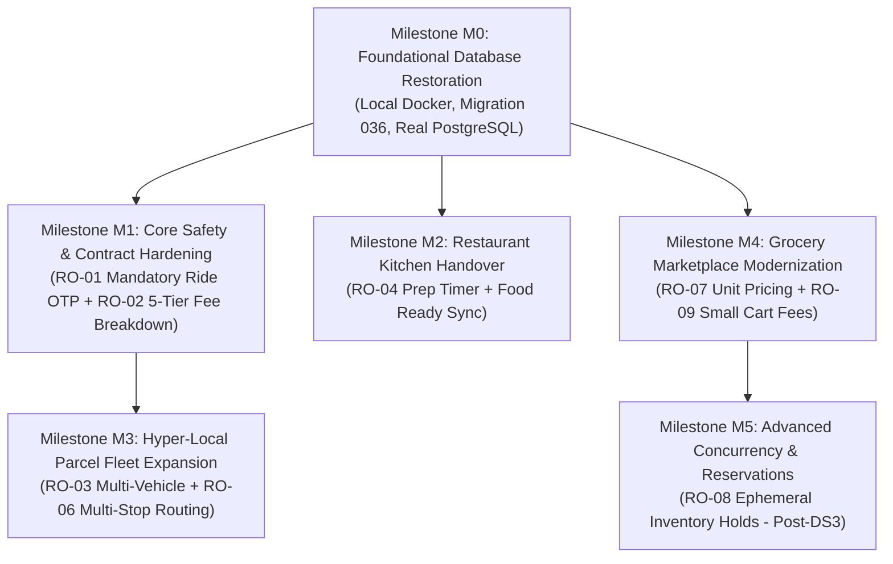

# NABIN — POST-COMPETITOR INVESTIGATION IMPLEMENTATION ROADMAP
## Architectural Blueprint, Gap Assessment & Milestone Delivery Plan

- **Document Version**: 1.0.0
- **Date**: October 11, 2026
- **Status**: SPECIFICATION & IMPLEMENTATION PLANNING ONLY (ZERO IMPLEMENTATION APPLIED)
- **Primary Brand Identifier**: NABIN Royal Indigo (`#1A3BA2`)
- **Author**: Principal Product Architect, Reverse Engineering & Marketplace Systems Specialist
- **Governance Alignment**: `AGENTS.md`, `GOVERNANCE.md`, `CURRENT_STATE.md`, `DECISIONS.md` (specifically DEC-001 through DEC-015)

---

## 1. Executive Summary

Following the deep competitor reverse-engineering and regulatory fact-check investigation documented in [`docs/NABIN_COMPETITOR_APP_INVESTIGATION.md`](file:///c:/Users/macmi/Documents/nabin/docs/NABIN_COMPETITOR_APP_INVESTIGATION.md) (v1.3.0), this implementation roadmap translates the findings into a phased, repository-grounded engineering plan for NABIN.

The analysis evaluates the six benchmark competitors (**Ola**, **Uber**, **Swiggy**, **Zomato**, **Porter**, and **Blinkit**) against the actual NABIN codebase across the unified Node.js backend (`backend/src/`), Flutter mobile applications (`mobile/`), Next.js customer web (`customer-web/`), admin web (`admin-web/`), and merchant web interfaces (`merchant-web/`, `restaurant-merchant-web/`, `grocery-merchant-web/`).

### Foundational Principles & Hard Constraints
1. **Zero Unapproved Implementation**: This roadmap is strictly planning and specification. No application source code has been altered, no database migrations have been applied, and remote Supabase remains completely untouched (`DEC-013`).
2. **PostgreSQL as Single Source of Truth**: All financial, catalog, and job state transitions must be authoritative in PostgreSQL (`DEC-003`, `DEC-004`). In-memory stores are temporary caches or offline fallback modes.
3. **Marketplace Model Governed by DEC-010**: NABIN does **not** operate captive dark stores, central fulfillment warehouses, or micro-warehouses. Grocery operations connect customers to physical independent retail merchants. Quick-commerce mechanisms (such as unit pricing and pre-checkout cart reservation locks) must be implemented strictly within this retail merchant marketplace framework.
4. **Primary Brand Identifier**: All user interface components, buttons, active states, and mobile splash themes must strictly preserve NABIN's brand identity: **Royal Indigo (`#1A3BA2`)**.

---

## 2. Technical Evaluation of Recommended Features (RO-01 to RO-09)

Every proposed capability has been cross-referenced against the actual repository files, tests, and database migrations.

### RO-01: Mandatory Ride-Start OTP Enforcement (Ola / Uber Benchmark)
- **Repository Evaluation**:
  - *What Exists*: Backend endpoint `POST /api/driver/verify-otp` ([`backend/src/server.js:7369`](file:///c:/Users/macmi/Documents/nabin/backend/src/server.js#L6080)) backed by authoritative database validation `db.validateAuthoritativeJobOtp` ([`backend/src/database.js:8603`](file:///c:/Users/macmi/Documents/nabin/backend/src/database.js#L8603)). Flutter driver screen [`mobile/lib/features/job/presentation/screens/active_job_execution_screen.dart:200-225`](file:///c:/Users/macmi/Documents/nabin/mobile/lib/features/job/presentation/screens/active_job_execution_screen.dart#L200) already captures the 4-digit code and calls `NabinApiService.submitTripOtp`. Completion route ([`server.js:6207-6230`](file:///c:/Users/macmi/Documents/nabin/backend/src/server.js#L6207)) rejects non-`IN_TRANSIT` trips with HTTP 409 `OTP_VERIFICATION_REQUIRED`.
  - *What is Missing*: Customer Flutter ride active screen and Customer Web ([`customer-web/src/app/rides/page.tsx`](file:///c:/Users/macmi/Documents/nabin/customer-web/src/app/rides/page.tsx)) need high-contrast, prominent 4-digit START OTP cards with verbal read-out guidance.
- **Status**: **PARTIALLY VERIFIED (BACKEND & DRIVER APP IMPLEMENTED; CUSTOMER UI CARDS REQUIRE PROMINENCE)**.
- **Affected Applications & Roles**: Mobile Customer (Rider), Mobile Driver, Backend Dispatch Engine.
- **Database Schema**: No migration required. `jobs.start_otp` is already persisted.
- **Security & Regulatory Considerations**: Must prevent brute-force attacks via rate limiting (maximum 3 failed OTP attempts before temporary 5-minute lockout). Complies with MoRTH Aggregator Guidelines passenger security mandates.
- **Measurable Acceptance Criteria**: Driver cannot transition ride to `IN_TRANSIT` without submitting the customer's 4-digit OTP; 3 failed attempts freeze verification; customer UI displays bold 4-digit OTP.

---

### RO-02: Transparent 5-Tier Itemized Checkout Fee Breakdown (Regulatory & Consumer Benchmark)
- **Repository Evaluation**:
  - *What Exists*: Upfront fare engine exists for rides ([`database.js:2544`](file:///c:/Users/macmi/Documents/nabin/backend/src/database.js#L2544)), and server-authoritative food pricing is verified in memory ([`OrderRepository.js:137`](file:///c:/Users/macmi/Documents/nabin/backend/src/repositories/OrderRepository.js#L137)).
  - *What is Missing*: Food checkout ([`server.js:4434-4480`](file:///c:/Users/macmi/Documents/nabin/backend/src/server.js#L4434)) currently charges only `grossFoodAmount - coupon.discount`. It lacks separate server calculations for Delivery Fee, Restaurant Packaging Fee, Platform Fee, and GST. Customer checkout screens render flat totals without statutory itemization.
- **Status**: **NOT IMPLEMENTED IN FOOD/GROCERY (AVAILABLE IN RIDE FARE ESTIMATES ONLY)**.
- **Affected Applications & Roles**: Customer Web, Mobile Customer, Backend Order Engine (`OrderRepository.js`).
- **Database Schema**: Requires extending `order_metadata` JSON or adding structured columns (`delivery_fee`, `packaging_fee`, `platform_fee`, `tax_amount`) in future migration.
- **Security & Regulatory Considerations**: Under Section 9(5) CGST Act (CBIC Circular No. 167/23/2021-GST), platform must collect 5% GST on restaurant food delivery and 18% GST on platform/delivery fees. All calculations must be server-authoritative to prevent client-side fee tampering.
- **Measurable Acceptance Criteria**: Customer checkout summary explicitly renders 5 distinct rows: `Item Subtotal`, `Packaging Charges`, `Delivery Partner Fee`, `Platform Fee`, and `Taxes (GST)`. Server validates and rejects any client payload attempting to override fees.

---

### RO-03: Multi-Vehicle Parcel Freight Fleet & Payload Limits (Porter Benchmark)
- **Repository Evaluation**:
  - *What Exists*: Backend supports single generic `PARCEL` service type ([`server.js:4200`](file:///c:/Users/macmi/Documents/nabin/backend/src/server.js#L4200)) using base fare matrix in `database.js:542`.
  - *What is Missing*: Multi-vehicle classification (`PARCEL_2W`, `PARCEL_3W`, `PARCEL_MINITRUCK`). No payload weight validation against vehicle limits (20kg for 2W, 500kg for 3W, 750kg for Mini Truck).
- **Status**: **NOT IMPLEMENTED (SINGLE 2W PARCEL CLASS ONLY)**.
- **Affected Applications & Roles**: Mobile Customer, Mobile Driver, Customer Web, Backend Pricing Engine.
- **Database Schema**: Requires updating `pricingConfig` / `pricing_configurations` table with distinct freight vehicle tiers and max payload attributes.
- **Security & Regulatory Considerations**: Commercial freight restrictions (municipal no-entry hours for commercial vehicles over 1 ton in city centers); driver license classification validation (commercial LMV transport license required for Mini Truck).
- **Measurable Acceptance Criteria**: Customer can select 2W, 3W, or Mini Truck; backend enforces payload caps; rates scale according to selected vehicle class.

---

### RO-04: Restaurant Prep Timer Countdown & "Food Ready" Handover Flow (Swiggy / Zomato Benchmark)
- **Repository Evaluation**:
  - *What Exists*: Backend endpoint `POST /api/merchant/orders/:orderId/status` ([`server.js:5506`](file:///c:/Users/macmi/Documents/nabin/backend/src/server.js#L4866)) accepts states `['ACCEPTED', 'REJECTED', 'PREPARING', 'PACKING', 'READY_FOR_PICKUP']` and broadcasts `NEW_JOB_DISPATCH` to drivers when `READY_FOR_PICKUP` is triggered.
  - *What is Missing*: The merchant cannot pass a custom prep time (e.g., `prepTimeMinutes: 25`). The merchant web app (`restaurant-merchant-web`) lacks an interactive countdown timer and audible alarm. Driver dispatch is not predictive.
- **Status**: **PARTIALLY VERIFIED (BACKEND STATE TRANSITIONS EXIST; PREP TIMER & PREDICTIVE DISPATCH MISSING)**.
- **Affected Applications & Roles**: Restaurant Merchant Web, Driver App, Customer Web/App, Backend Dispatch.
- **Database Schema**: No migration required; `metadata.prep_time_minutes` can be stored in `orders.metadata` JSONB.
- **Security & Regulatory Considerations**: Merchant authentication and tenant isolation (`requireMerchantTenant`) already enforced in `server.js:4866`.
- **Measurable Acceptance Criteria**: Merchant accepts order with prep time (15/25/40 mins); customer UI displays synchronized countdown timer; merchant trigger of `READY_FOR_PICKUP` alerts driver to collect food.

---

### RO-05: Driver Earnings & Instant Withdrawal Capabilities (Uber Flex Pay Benchmark)
- **Repository Evaluation**:
  - *What Exists*: Endpoints `POST /api/driver/payout-destination/request` ([`server.js:7890`](file:///c:/Users/macmi/Documents/nabin/backend/src/server.js#L6279)) and `POST /api/driver/payout` ([`server.js:7900`](file:///c:/Users/macmi/Documents/nabin/backend/src/server.js#L6289)). Flutter screen `DriverPayoutScreen` ([`mobile/lib/features/payout/presentation/screens/driver_payout_screen.dart`](file:///c:/Users/macmi/Documents/nabin/mobile/lib/features/payout/presentation/screens/driver_payout_screen.dart)) is implemented and tested (`mobile/test/driver_payout_test.dart`). Backend enforces KYC verification, cooling periods, idempotency, and double-entry ledger bookkeeping.
  - *What is Missing*: Production integration with live bank payout API (e.g., RazorpayX / Cashfree Payouts). Currently operates against local database ledger functions.
- **Status**: **VERIFIED IN CONTRACT & APPLICATION REPOSITORIES (PENDING LIVE BANKING GATEWAY)**.
- **Affected Applications & Roles**: Mobile Driver, Backend Payment Engine (`PaymentRepository.js`, `DriverRepository.js`).
- **Database Schema**: Fully supported by migrations 004 (ledger) and 016 (driver KYC & payouts).
- **Security & Regulatory Considerations**: DEC-015 strictly prohibits synthetic VPAs. Cooling periods (typically 24 hours after bank account change) prevent account takeover draining.
- **Measurable Acceptance Criteria**: Driver can initiate payout; backend validates KYC and cooling status; balance mutates atomically in double-entry ledger.

---

### RO-06: Multi-Stop Parcel Delivery Routing (Porter Benchmark)
- **Repository Evaluation**:
  - *What Exists*: Single point-to-point parcel booking ([`server.js:4239-4240`](file:///c:/Users/macmi/Documents/nabin/backend/src/server.js#L4239)).
  - *What is Missing*: Data structures for intermediate waypoints (`drops: [{ lat, lng, contact, package }]`). Route distance summation across multiple segments. Driver multi-stop delivery progression.
- **Status**: **NOT IMPLEMENTED**.
- **Affected Applications & Roles**: Customer Web, Mobile Customer, Mobile Driver, Backend Job Engine.
- **Database Schema**: Requires updating `jobs.drop` to support an ordered `waypoints` JSONB array or intermediate stop table.
- **Security & Regulatory Considerations**: Separate delivery OTP per stop to ensure proof of delivery at each location.
- **Measurable Acceptance Criteria**: Customer can configure up to 3 intermediate drop-offs; fare sums each segment distance; driver app steps through waypoint sequence with dedicated OTP at each drop.

---

### RO-07: Grocery Pack Sizes & Statutory Unit Pricing (Blinkit Benchmark)
- **Repository Evaluation**:
  - *What Exists*: `master_grocery_catalog` has `standard_unit` and `pack_size` (text), and `merchant_grocery_inventory` tracks `store_price` ([`supabase/migrations/013_grocery_store_integration.sql`](file:///c:/Users/macmi/Documents/nabin/supabase/migrations/013_grocery_store_integration.sql)).
  - *What is Missing*: Structured unit economics: `pack_quantity` (numeric), `pack_unit` (`g`, `kg`, `ml`, `l`, `pcs`), and automated server calculation of unit price display (e.g., ₹48/100g, ₹240/kg) required by Legal Metrology (Packaged Commodities) Rules.
- **Status**: **PARTIALLY VERIFIED (BASIC TEXT FIELDS EXIST; STRUCTURED UNIT RATE ENGINE MISSING)**.
- **Affected Applications & Roles**: Grocery Merchant Web, Customer Web/App, Backend Grocery Catalog.
- **Database Schema**: Requires adding `pack_unit` and `pack_quantity` columns to `master_grocery_catalog`.
- **Security & Regulatory Considerations**: Legal Metrology compliance mandates unit rate display on all packaged consumer goods.
- **Measurable Acceptance Criteria**: Grocery products render clear unit rate (e.g. ₹/100g) alongside MRP and merchant selling price.

---

### RO-08: Pre-Checkout Grocery Inventory Reservation Holds
- **Repository Evaluation**:
  - *What Exists*: Real-time stock checked on checkout; `darkStoreService.js:26` explicitly notes: *"Reservations are intentionally absent: they depend on an order identity DS-3 has not settled."*
  - *What is Missing*: Ephemeral stock reservation lock during active checkout sessions.
  - *Crucial Governance Constraint*: Under **DEC-010**, NABIN is a physical retail merchant marketplace, NOT a dark store operator. Pre-checkout holds must decrement `merchant_grocery_inventory.stock_quantity` temporarily with a 10-minute TTL, avoiding warehouse WMS assumptions.
- **Status**: **NOT IMPLEMENTED (DECISION DS-3 UNSETTLED)**.
- **Affected Applications & Roles**: Customer Web/App, Backend Inventory Engine.
- **Database Schema**: Requires an ephemeral `inventory_reservations` table with expiration timestamps.
- **Security & Regulatory Considerations**: High-concurrency race condition protection; automatic background TTL expiry worker to prevent inventory hoarding.
- **Measurable Acceptance Criteria**: Adding the last item to a cart reserves it for 10 minutes; other customers see "Reserved"; expires automatically if cart abandoned.

---

### RO-09: Configurable Grocery Small-Cart & Handling Fee Engine
- **Repository Evaluation**:
  - *What Exists*: Grocery catalog browsing in `server.js:6977`.
  - *What is Missing*: Tiered small-cart surcharge (e.g., ₹15 if subtotal < ₹149) and flat platform handling charge (₹5) in grocery checkout math.
- **Status**: **NOT IMPLEMENTED**.
- **Affected Applications & Roles**: Customer Web/App, Backend Order Engine.
- **Database Schema**: Configurable fee parameters stored in `pricing_configurations` or platform settings table.
- **Security & Regulatory Considerations**: Server-authoritative calculation; full disclosure before payment to comply with Consumer Protection (E-Commerce) Rules against hidden drip pricing.
- **Measurable Acceptance Criteria**: Grocery checkout dynamically evaluates cart subtotal; transparently adds small cart fee if below threshold and itemizes handling charge.

---

## 3. Implementation Order & Dependency Topology

### Categorization by Prerequisite & Constraint

| Classification | Items | Rationale / Constraints |
| :--- | :--- | :--- |
| **P0: Foundational Blocker** | **Milestone M0 (Local DB Restoration)** | Migration 036 unapplied; Docker stopped; must validate Phase C in real PostgreSQL before proceeding. |
| **P1: Zero-Migration Quick Wins** | **RO-01 (Ride OTP Cards), RO-04 (Prep Timer)** | Uses existing backend routes and metadata fields; no database migrations required. |
| **P2: Critical Financial Transparency** | **RO-02 (5-Tier Fee Breakdown)** | Essential for consumer protection and tax compliance; server-authoritative calculations. |
| **P3: High-Value Logistics Expansion** | **RO-03 (Parcel Fleet), RO-06 (Multi-Stop)** | Expands market capture for SME transport; requires pricing configuration schema updates. |
| **P4: Grocery Marketplace Parity** | **RO-07 (Unit Pricing), RO-09 (Small Cart Fee)** | Governed by DEC-010 (physical store marketplace model); improves unit economics. |
| **P5: Complex Concurrency** | **RO-08 (Inventory Reservations)** | Requires formal DS-3 architectural decision and background TTL worker. |

---

## 4. Milestone M0: Foundational Local Database Restoration Gate

Before implementing new features, the repository must resolve the database environment blocker identified during Phase C.

### 4.1 Objectives & Scope
- Start Docker Desktop engine on the local host machine.
- Verify local PostgreSQL container operational on port 5432 / 54321.
- Apply migration [`supabase/migrations/036_restaurant_catalog_persistence_and_variants.sql`](file:///c:/Users/macmi/Documents/nabin/supabase/migrations/036_restaurant_catalog_persistence_and_variants.sql) to the isolated local instance.
- Run [`backend/restaurant_catalog_checkout_test.js`](file:///c:/Users/macmi/Documents/nabin/backend/restaurant_catalog_checkout_test.js) against real PostgreSQL (proving 0 fallback store warnings, real table persistence of `variants` and `add_on_groups`).
- Confirm zero modifications to remote Supabase (`DEC-013`).

### 4.2 Definition of Done for M0
1. `docker info` returns clean operational engine.
2. Local PostgreSQL responds on port 5432 / 54321.
3. Migration 036 successfully applied to local database.
4. `restaurant_catalog_checkout_test.js` exits code 0 with `PostgreSQL persistence verified: YES`.
5. `HEAD == origin/main` preserved.

---

## 5. Phased Implementation Milestones (M1 through M5)

### Milestone M1: Core Safety & Financial Transparency (RO-01 & RO-02)
- **Goal**: Guarantee zero phantom rides via verified OTP gates and deliver full fee transparency across food checkout.
- **Affected Files**:
  - `customer-web/src/app/rides/page.tsx`
  - `customer-web/src/app/food/page.tsx`
  - `mobile/lib/features/job/presentation/screens/active_job_execution_screen.dart`
  - `backend/src/repositories/OrderRepository.js`
  - `backend/src/server.js`
- **Contract & API Changes**:
  - Update `POST /api/customer/book-food` response payload to include itemized breakdown: `{ subtotal, packagingFee, deliveryFee, platformFee, taxAmount, totalAmount }`.
- **Security & Failure Handling**: Reject any client request containing tampered fee totals. Rate-limit OTP entries.
- **Acceptance Criteria**:
  - Customer ride screen displays bold 4-digit OTP; driver app accepts and transitions ride to `IN_TRANSIT`.
  - Customer food checkout renders transparent 5-tier fee summary. All fees calculated server-side.
- **Verification Tests**: Add `backend/food_fee_transparency_test.js` (asserting fee calculations, tax amounts, and coupon interactions).

---

### Milestone M2: Restaurant Kitchen Handover & Prep Synchronization (RO-04)
- **Goal**: Synchronize delivery courier dispatch with actual restaurant cooking completion to eliminate food idle time.
- **Affected Files**:
  - `restaurant-merchant-web/src/pages/Orders.tsx`
  - `backend/src/server.js` (`POST /api/merchant/orders/:orderId/status`)
  - `customer-web/src/app/food/orders/[id]/page.tsx`
- **Contract & API Changes**:
  - `POST /api/merchant/orders/:orderId/status` accepts optional body `{ status: 'ACCEPTED', prepTimeMinutes: 25 }`.
  - WebSocket event `FOOD_ORDER_UPDATE` propagates `prepTimeMinutes` and `estimatedReadyAt` timestamp to customer.
- **Security & Failure Handling**: Tenant verification (`requireMerchantTenant`) ensures merchant can only mutate own orders.
- **Acceptance Criteria**:
  - Merchant selects prep time (15, 25, 40 min); customer UI displays active cooking countdown timer.
  - Merchant status trigger `READY_FOR_PICKUP` emits dispatch notification to couriers.
- **Verification Tests**: Add `backend/restaurant_prep_workflow_test.js`.

---

### Milestone M3: Hyper-Local Freight Logistics Fleet & Multi-Stop Routing (RO-03 & RO-06)
- **Goal**: Expand NABIN Parcel from a single 2-wheeler courier service into a multi-vehicle intra-city logistics platform for SME goods movement.
- **Affected Files**:
  - `backend/src/database.js` (`this.pricingConfig`)
  - `backend/src/repositories/PricingRepository.js`
  - `backend/src/server.js` (`POST /api/customer/book-parcel`)
  - `customer-web/src/app/parcel/page.tsx`
- **Contract & API Changes**:
  - Expand `POST /api/customer/book-parcel` payload to accept `{ vehicleType: '2W' | '3W' | 'MINITRUCK', waypoints: [{ address, lat, lng, contactPhone }] }`.
- **Security & Failure Handling**: Validate payload limits (rejecting >20kg on 2W, >500kg on 3W, >750kg on Mini Truck). Ensure distinct delivery OTP generated for each intermediate drop.
- **Acceptance Criteria**:
  - Customer can select 2W, 3W, or Mini Truck with distinct rate cards.
  - Multi-stop route calculates cumulative distance and steps through sequential waypoints.
- **Verification Tests**: Add `backend/parcel_multivehicle_routing_test.js`.

---

### Milestone M4: Grocery Marketplace Modernization (RO-07 & RO-09)
- **Goal**: Bring statutory unit-pricing transparency and viable unit economics to NABIN Grocery physical retail marketplace.
- **Affected Files**:
  - `backend/src/server.js` (`/api/grocery/products`)
  - `backend/src/repositories/OrderRepository.js`
  - `grocery-merchant-web/src/pages/Inventory.tsx`
  - `customer-web/src/app/grocery/page.tsx`
- **Contract & API Changes**:
  - `/api/grocery/products` response includes structured unit pricing: `{ sellingPrice, packQuantity: 500, packUnit: 'g', unitRateDisplay: '₹48/100g' }`.
  - Grocery checkout evaluates subtotal and applies configurable small-cart fee (< ₹149) and handling charge (₹5).
- **Security & Failure Handling**: Enforce DEC-010 (marketplace model connecting to physical retail stores). All fee additions explicitly itemized before payment.
- **Acceptance Criteria**:
  - Packaged items display unit rate conforming to Legal Metrology standards.
  - Small grocery carts apply small-cart surcharge and handling charge server-side.
- **Verification Tests**: Add `backend/grocery_pricing_unit_test.js`.

---

### Milestone M5: Concurrency & Ephemeral Pre-Checkout Inventory Holds (RO-08)
- **Goal**: Prevent checkout out-of-stock race conditions on high-velocity grocery products.
- **Prerequisites**: Requires formal architectural decision on Decision DS-3 (settling order identity during pre-checkout reservation).
- **Affected Files**:
  - `backend/src/services/darkStoreService.js` / `backend/src/services/inventoryDomain.js`
  - `backend/src/repositories/OrderRepository.js`
- **Contract & API Changes**:
  - `POST /api/grocery/cart/reserve` creates an ephemeral 10-minute hold: `{ merchantId, items: [{ productId, quantity }], holdToken }`.
- **Security & Failure Handling**: Automatic TTL expiry worker cleans abandoned holds after 10 minutes. Hold must not prevent other customers from buying if cart is abandoned.
- **Acceptance Criteria**:
  - Adding item to cart creates 10-minute hold; stock updates across concurrent customers; abandoned carts release stock automatically.
- **Verification Tests**: Add `backend/grocery_inventory_reservation_concurrency_test.js`.

---

## 6. Verification Gates & Governance Checklist

Every implementation milestone must pass through the following strict completion gate before committing:

1. **Pre-Task Check Protocol**:
   - Check Git status: `git status`, `git rev-parse HEAD`, `git rev-parse origin/main`.
   - Ensure clean working tree and `HEAD == origin/main`.
2. **Implementation Boundaries**:
   - Follow `AGENTS.md` and `GOVERNANCE.md`.
   - Never modify historical migrations 001–016.
   - Remote Supabase is off-limits (`DEC-013`).
3. **Automated Test Validation**:
   - Run milestone-specific integration tests.
   - Run full regression chain (`npm test` and `restaurant_catalog_checkout_test.js`).
   - Run documentation citation guard: `node backend/doc_citation_guard_test.js`.
4. **Git Loss-Prevention Protocol**:
   - Add specific changed files.
   - Commit with structured commit message.
   - Push to `origin/main`.
   - Verify `HEAD == origin/main: YES`.

---

## 7. Unresolved Product, Technical & Regulatory Questions

1. **DEC-010 Marketplace Alignment for Inventory Holds (RO-08)**:
   - Since NABIN connects to independent retail grocery stores rather than operating dark store warehouses, does a physical grocery merchant have sufficient inventory tracking precision to support automated 10-minute cart reservation holds?
2. **Municipal Freight Restriction Rules (RO-03)**:
   - Mini Trucks (Tata Ace, 750kg) and Pickups face daytime municipal entry restrictions in dense city centers (e.g. Delhi, Bengaluru). Should the platform restrict Mini Truck bookings during designated peak traffic hours?
3. **Packaging GST Classification (RO-02)**:
   - Should restaurant packaging charges be taxed at 5% (as composite restaurant service supply) or 18% (pure packaging supply)? A formal tax legal opinion should be confirmed prior to M1 rollout.
4. **Offline Driver OTP Fallback (RO-01)**:
   - In areas of degraded cellular connectivity (underground parking, rural pickup points), how should the driver app handle OTP verification when the server cannot be reached? (e.g., cryptographic offline token signature vs manual support bypass).

---

## 8. Safety & Integrity Confirmation

- **Application Source Code**: 0 files modified.
- **Database Migrations**: 0 migrations modified, created, or executed.
- **Remote / Shared Infrastructure**: Completely untouched.
- **Existing User Work**: Preserved in working tree.
- **Git State**: Clean on tracked files; `HEAD == origin/main`.
