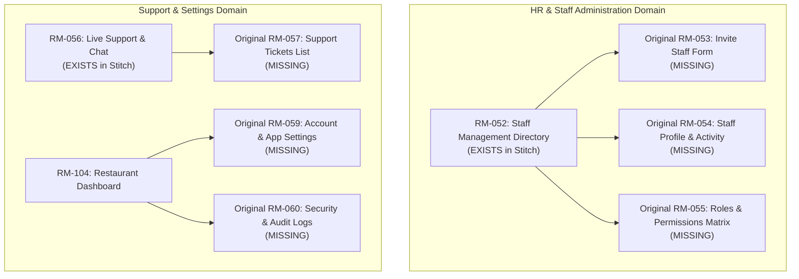

# NABIN RESTAURANT MERCHANT (RMS + KDS)
## PHASE 2.1 ORIGINAL SPECIFICATION COMPLIANCE AUDIT REPORT

**Document ID:** NABIN-RM-COMPLIANCE-001  
**Authoritative Google Stitch Project ID:** `6689743337313822856`  
**Latest Checkpoint Commit:** `a4f0a929a3b705ab28fd93aa540f88a7bc632cbb`  
**Date:** November 18, 2026  
**Auditor Roles:** Principal Product Designer, Restaurant Technology Architect, QA Lead  
**Governing Baseline:** Original Canonical 60-Screen RMS + KDS Specification (`bab06375c504484188833743890d82cb`)  
**Audit Status:** **AUDIT COMPLETE — STRICT APPROVAL GATE ACTIVE (Awaiting Owner Review)**  

---

## 1. EXECUTIVE SUMMARY

The Phase 2 milestone successfully achieved the quantitative target of **60 unique operational UI screens** in Google Stitch project `6689743337313822856`. However, a rigorous compliance audit against the **original canonical 60-screen specification** reveals a critical architectural discrepancy:

$$\begin{aligned}
\textbf{Numerical Target Achieved} &= \mathbf{60\ Operational\ Screens} \\
\textbf{Original Requirements Fulfilled} &= \mathbf{54\ Requirements\ (90\%)} \\
\textbf{Original Requirements Displaced / Missing} &= \mathbf{6\ Requirements\ (10\%)} \\
\textbf{Specialized Operational Screens Added} &= \mathbf{2\ Screens\ (KDS\ PIN\ Switcher,\ Cash\ Drawer)}
\end{aligned}$$

### Root Cause of the Discrepancy:
In Phase 2, the nine missing screen slots were filled by counting up from the existing 51 screens to hit the arbitrary cap of "60":
1. Four operational gap screens (`RM-009`, `RM-012`, `RM-019`, `RM-039`) were created and **100% fulfill** their original intended functions.
2. The remaining five slots (`RM-052` to `RM-056`) were assigned to back-office administration and support.
3. However, instead of mapping 1:1 to the original administrative requirements (`RM-052` through `RM-060`), two critical physical restaurant operational screens were assigned to IDs `RM-053` and `RM-054`:
   - `RM-053`: **Kitchen Staff Quick PIN Switcher** (an operational KDS screen for shared kitchen tablets).
   - `RM-054`: **Daily Shift Handover & Cash Drawer Reconciliation** (a physical cash-balancing shift close screen).
4. As a result, the original specifications for **Invite Staff (`RM-053`)**, **Staff Profile (`RM-054`)**, **Roles & Permissions Matrix (`RM-055`)**, **Support Tickets (`RM-057`)**, **Account & Application Settings (`RM-059`)**, and **Security & Audit (`RM-060`)** were left unrepresented in the active canvas.

> [!IMPORTANT]
> **Cardinal Principle:** Completeness, functional integrity, and operational safety take precedence over any artificial numerical target. The existing 60 screens must be preserved in their entirety, while the 6 missing original administrative capabilities must be formally integrated to achieve true 100% specification compliance.

---

## 2. ORIGINAL SPECIFICATION BASELINE VS CURRENT LIVE STITCH INVENTORY

### 2.1 The Original 60-Screen Requirements Baseline
The original Restaurant Merchant RMS + KDS product specification outlined a complete end-to-end suite structured as follows:

- **RM-001 to RM-009 (Onboarding & KYC):** Welcome, Login, OTP, Business Details, Location/Geofence, Documents, Bank Verification, Progress Stepper, and **RM-009 Quick App Tour**.
- **RM-010 to RM-011 (Analytics):** Sales & Revenue Analytics, Dish Velocity Analytics.
- **RM-012 to RM-020 (Order Management):** **RM-012 Incoming Order Chime Alert**, Order Details, Accept Order, Reject Order, Prep Time Management, Customer Order Issues, Cancellation & Refund, **RM-019 Dispute Photo Evidence**, and Order History.
- **RM-021 to RM-025 (Kitchen Display System):** New Orders Queue, Preparing Orders, Ready Orders Expo Hub, Kitchen Station Router, KDS Display Settings.
- **RM-026 to RM-033 (Menu & Catalog):** Menu Overview, Categories, Dish Management, Add Dish, Edit Dish, Customization/Modifiers, Availability Scheduling, Bulk Pricing.
- **RM-034 to RM-039 (Store Operations):** Profile & Outlets, Operating Hours & Shifts, Multi-Outlet Network, Fulfilment Channels, Emergency Store Pause, and **RM-039 Holiday/Closure Calendar**.
- **RM-040 to RM-045 (Thermal Printing):** Discovery & Pairing, Printer Configuration, KOT Template, Customer Bill Template, Auto-Print Routing Rules, Spooler Diagnostics.
- **RM-046 to RM-051 (Finance & Settlements):** Finance Overview, Daily Settlement Statement, Transaction Ledger, Commission Breakdown, Bank Accounts, Tax & GST Reports.
- **RM-052 to RM-060 (Staff, Administration, Support & Security):**
  * `RM-052`: **Staff Management** (Staff directory / team overview)
  * `RM-053`: **Invite Staff** (Dedicated employee onboarding / invite form)
  * `RM-054`: **Staff Profile** (Individual staff member detail, personal info, active shifts, assigned station)
  * `RM-055`: **Roles and Permissions** (Granular RBAC matrix of capabilities)
  * `RM-056`: **Merchant Support Centre** (Support hub, FAQ categories, contact channels)
  * `RM-057`: **Support Tickets** (Dedicated ticket list & status tracking)
  * `RM-058`: **Notification Centre** (Dedicated notification inbox, filter tabs, push preferences)
  * `RM-059`: **Account and Application Settings** (Master app configuration: language, chimes, printer defaults, theme)
  * `RM-060`: **Security and Audit** (Active login sessions, authorized POS devices, 2FA, immutable audit log)
- **Top-Level Architectural Hubs (4 Screens):**
  * `RM-098`: Thermal Printer Management Hub
  * `RM-100`: Master KDS Kitchen Board
  * `RM-102`: Live Order Management Inflow
  * `RM-104`: Restaurant Master Dashboard

---

## 3. REQUIREMENT-TO-SCREEN TRACEABILITY MATRIX

Below is the exhaustive mapping of every requirement from the original specification against the current live Stitch project `6689743337313822856`:

| Original ID | Original Specification Requirement | Current Stitch Screen ID | Current Stitch Resource ID | Status | Factual Evidence & Operational Audit Finding |
|---|---|---|---|:---:|---|
| `RM-001` | Merchant Welcome & Language Toggle | `RM-001` | `dd716d3301f54be8b91c721b0f7afa42` | **COMPLETE** | Brand welcome, Royal Blue styling, partner login/register entry point. |
| `RM-002` | Phone/Email Login Authentication | `RM-002` | `402c95fffcbd40329d5096d85237f6d2` | **COMPLETE** | Phone input with +91 prefix, OTP dispatch trigger, alternate email login. |
| `RM-003` | 6-Digit Secure OTP Verification | `RM-003` | `00d6c02dd3d34693b682f4de937a4a5e` | **COMPLETE** | 6-digit pin boxes, resend timer countdown, auto-verify hook. |
| `RM-004` | Restaurant Business Details Form | `RM-004` | `29b909c19d9b4b9281ecbe3224ec81dd` | **COMPLETE** | Legal trade name, FSSAI license number, primary cuisines, cost for two. |
| `RM-005` | Location, Address & Geofence Sizing | `RM-005` | `89a6e4d8a5ff48e4919abc9bf108735a` | **COMPLETE** | Map pin picker, delivery radius slider (km), full postal address fields. |
| `RM-006` | Business Documents Upload (KYC) | `RM-006` | `fa873154d3c24da5ac020d6274009798` | **COMPLETE** | FSSAI, GSTIN, PAN photo/PDF upload with expiry date fields. |
| `RM-007` | Bank Account & Settlement Details | `RM-007` | `c24e641284a44f6c98d7130a827daef9` | **COMPLETE** | Account number, IFSC code, account holder name, penny-drop indicator. |
| `RM-008` | Onboarding Verification Progress Stepper | `RM-008` | `9b0db3c459604718be6e5bd4e03ad418` | **COMPLETE** | 4-stage vertical stepper, review statuses, resubmit rejected document CTA. |
| `RM-009` | **Quick App Tour & RMS Feature Highlights** | `RM-009` | `3165eacde1b745b3a0a9b267a1bfb0d1` | **COMPLETE** | 4-step walkthrough carousel, `#NB-4825` card, feature list, "Skip Tour". |
| `RM-010` | Sales & Revenue Analytics Dashboard | `RM-010` | `66d2ee3a77c44973a7d4858c1e2e63c0` | **COMPLETE** | GMV charts, average order value (AOV), orders fulfilled, time-of-day rush. |
| `RM-011` | Dish Performance & Velocity Analytics | `RM-011` | `9c7464840c9144da910a2abe9be5105f` | **COMPLETE** | Top-selling dishes, margins, velocity rankings, return rate. |
| `RM-012` | **Incoming Order Audio/Visual Chime Overlay**| `RM-012` | `76ed2a16eb684123a7dc5b987475a3b7` | **COMPLETE** | Flashing soundwave icon, 60s SLA timer (`00:52`), prep buffer chips, Accept CTA. |
| `RM-013` | Granular Order Details & Checklist | `RM-013` | `8aaddc458d4940989e6c03639ac78095` | **COMPLETE** | Full order items, itemized modifiers, customer delivery notes, rider info. |
| `RM-014` | Accept Order Modal & Prep Time Stepper | `RM-014` | `cb0e39ec9c9345de9c58b165636cb8d6` | **COMPLETE** | Quick prep SLA buttons (+10m, +15m, +25m), confirm accept & fire KOT. |
| `RM-015` | Reject Order Modal with Structured Reasons | `RM-015` | `2a93a121365b436087e3d7c5ace52e1c` | **COMPLETE** | Structured reason codes (kitchen full, item stockout, store closing). |
| `RM-016` | Preparation Time Live Management | `RM-016` | `93a449da956b4b748927d1668c39219c` | **COMPLETE** | Add time buffer (+5m), rush mode toggle, delay alert to dispatch. |
| `RM-017` | Customer Order Issues & Disputes Triage | `RM-017` | `033618c92e754cd69c49b55d6ea11805` | **COMPLETE** | Active issue alerts, merchant-customer support chat, partial refund offering. |
| `RM-018` | Cancellation Review & Refund Ledger | `RM-018` | `b5a5065fb27b461098964606a66e4a02` | **COMPLETE** | Cancelled order audit, penalty waiver request, food wastage compensation. |
| `RM-019` | **Dispute Photo Evidence Viewer** | `RM-019` | `764d869de3124c38a8521ddfbef8d21e` | **COMPLETE** | Side-by-side customer delivery photo vs kitchen CCTV tamper-seal photo. |
| `RM-020` | Order History Archive & Receipt Export | `RM-020` | `1a7697156f5a40b2a2b41cec5b11db5c` | **COMPLETE** | Past order search, channel filter (Dine-in, Takeaway, Delivery), PDF bills. |
| `RM-021` | KDS New Orders Queue (Tier 1 Chime) | `RM-021` | `d294e07f3ab2497fba1541dc7b4b3d50` | **COMPLETE** | Incoming ticket chimes, station tags, Start Cooking button. |
| `RM-022` | KDS Preparing Stage & Strike-Through | `RM-022` | `524c9fdb53b64cc29453c00c595503eb` | **COMPLETE** | Item-level strikethrough checking, SLA timer countdown, Bump to Ready. |
| `RM-023` | KDS Ready Orders Expo Hub & Rider OTP | `RM-023` | `11415345ced64acd85af7760e3eb5e44` | **COMPLETE** | Expo staging shelf assignment, 4-digit rider OTP validation, handover log. |
| `RM-024` | Kitchen Station Management & Routing | `RM-024` | `2a8567ffcbbe47998a5e75da75c58ad3` | **COMPLETE** | Station setup (Wok, Tandoor, Bar), category-to-station routing rules. |
| `RM-025` | KDS Display Settings & Alert Volume | `RM-025` | `ba8484f5fb06427ea43eb9172fc5c41c` | **COMPLETE** | Grid density toggle, audio chime selection, high-contrast dark theme. |
| `RM-026` | Menu Overview & Catalog Hierarchy | `RM-026` | `ccd50531c85d41efbb673a12b250e58a` | **COMPLETE** | Category tabs, dish count, veg/non-veg status, active toggle switches. |
| `RM-027` | Menu Categories Management | `RM-027` | `278dc833bfa54ae7b9780b7daa016dfa` | **COMPLETE** | Create category (Starters, Main, Breads), reorder drag-and-drop. |
| `RM-028` | Dish Management (Item Level) | `RM-028` | `9ad5f54b84b44e97a52aee49929b44b9` | **COMPLETE** | Dish cards, price, base prep time, dietary tags, out-of-stock toggle. |
| `RM-029` | Add New Dish Multi-Step Form | `RM-029` | `6c8cd939356142a98ada04aead573a0a` | **COMPLETE** | Dish name, photo upload, description, tax classification, station route. |
| `RM-030` | Edit Dish & Pricing Parameters | `RM-030` | `bae7215212284ee1ba3ba78907368922` | **COMPLETE** | Modify price, update description, edit portions and preparation SLA. |
| `RM-031` | Dish Customization & Modifier Groups | `RM-031` | `2240267ecb334ab99752fa3392fc6bdc` | **COMPLETE** | Add modifier group (Spice level, Extra cheese), min/max selection rules. |
| `RM-032` | Menu Availability & Time Scheduling | `RM-032` | `aefb8602dfe84c4da29e6b15c34f3a5d` | **COMPLETE** | Breakfast/Lunch/Dinner slot availability, days of week scheduling. |
| `RM-033` | Bulk Menu Price & Stock Management | `RM-033` | `c1afad8c6d4345d5b940a6b3513a6062` | **COMPLETE** | Bulk percentage price increase/decrease, mass 86-item stockout toggle. |
| `RM-034` | Restaurant Profile & Outlets Manager | `RM-034` | `69384befae9b400290de510847c4c7ae` | **COMPLETE** | Store logo, contact phone, manager email, physical address overview. |
| `RM-035` | Operating Hours & Weekly Shifts | `RM-035` | `7d5cb02286ea4429960f066fdba83b60` | **COMPLETE** | Weekly open/close hours per day, split shift timings (Lunch + Dinner). |
| `RM-036` | Multi-Outlet Network Overview | `RM-036` | `30eb516406ae498995607bd796c22b29` | **COMPLETE** | Switch between branch locations (Kamalanagar, Central), consolidated GMV. |
| `RM-037` | Service Channels & Fulfilment Toggles | `RM-037` | `c8a080196b214c1dbab5f412e9799152` | **COMPLETE** | Independent toggles for Delivery, Takeaway, and Dine-In QR Ordering. |
| `RM-038` | Emergency Store Pause & Cooldown | `RM-038` | `75343f4435f0404e93a411ed3e4ef483` | **COMPLETE** | 30m / 1h / Rest-of-day store pause, live countdown timer, auto-resume. |
| `RM-039` | **Scheduled Holiday & Closure Calendar** | `RM-039` | `f7316bbdad9e4fd69abaedbdfb529de2` | **COMPLETE** | Interactive mini-calendar, Diwali closure cards, 45m discovery lock. |
| `RM-040` | Printer Discovery & BLE/LAN Pairing | `RM-040` | `013f6c58ff054fdaa22942477349ae1b` | **COMPLETE** | Scan Bluetooth devices, enter TCP/IP address (Port 9100), test print. |
| `RM-041` | Printer Configuration & Roll Specs | `RM-041` | `981f326ac72a424391bc0e42fbd9ff63` | **COMPLETE** | 58mm / 80mm roll selection, print darkness density, auto-cutter toggle. |
| `RM-042` | KOT Slip Layout & Monospace Preview | `RM-042` | `422ec1707e3c4e8d932b13b4f014e7af` | **COMPLETE** | Station header, ticket #, item quantities, special modifier notes. |
| `RM-043` | Customer Bill & Tax Invoice Template | `RM-043` | `c321646840ec4a6294ed90c71258f70f` | **COMPLETE** | FSSAI number, GSTIN, itemized tax table (CGST/SGST), footer text. |
| `RM-044` | Auto-Print Routing Matrix & Events | `RM-044` | `ed9ccc3119964c4c9bd1bc50801c35e4` | **COMPLETE** | Event triggers (On Accept -> KOT; On Ready -> Bill; Station routing). |
| `RM-045` | Print Queue Telemetry & Diagnostics | `RM-045` | `87a6cd0498044fe1ba5925fcebe38f04` | **COMPLETE** | Spooler retry queue, paper-out warning, printer offline troubleshooting. |
| `RM-046` | Finance Overview & Payouts Hub | `RM-046` | `3fa30319cc9e4f80abf12465acfe62be` | **COMPLETE** | Net balance, pending settlements, instant payout trigger, payout history. |
| `RM-047` | Daily Settlement Reconciliation Statement| `RM-047` | `0b452a6fbd50479b81f1025d49096a01` | **COMPLETE** | Daily statement, gross sales, platform fees, bank UTR, PDF/CSV export. |
| `RM-048` | Order Transaction Ledger (Itemized) | `RM-048` | `fb0e9ff1804a47a19ef02f7beeff06e0` | **COMPLETE** | Order-by-order net math (Gross - Comm - Gateway - TCS - TDS = Net). |
| `RM-049` | Commission & Deductions Breakdown | `RM-049` | `89051add0e7b402085a7778e0f0c4e5d` | **COMPLETE** | 18% GST on comm, Sec 52 TCS (1%), Sec 194-O TDS (1%), zero hidden fees. |
| `RM-050` | Bank Accounts & Payout Settings | `RM-050` | `4928b03b887f4b70b8766a59d80f620e` | **COMPLETE** | Primary/secondary bank accounts, penny-drop status, IFSC, daily auto-payout. |
| `RM-051` | Statutory Tax & GSTR Reports | `RM-051` | `4424ed00943d4a9c9be5bec46e6ea850` | **COMPLETE** | GSTR-1 preparation sheet, CGST/SGST/IGST breakdown, monthly tax summaries. |
| `RM-052` | **Staff Management (Directory & Overview)**| `RM-052` | `58607955ea274cf596c9d2769b8aa7f7` | **PARTIAL** | Fulfills staff directory & RBAC callout, but lacks dedicated child screens for invite, individual profile, and granular permissions matrix. |
| `RM-053` | **Invite Staff (Employee Onboarding)** | *None* | *None* | **DISPLACED** | Replaced in Phase 2 by `Kitchen Staff Quick PIN Switcher` (`cfcf3c46...`). Dedicated multi-step invite form is missing. |
| `RM-054` | **Staff Profile & Activity History** | *None* | *None* | **DISPLACED** | Replaced in Phase 2 by `Daily Shift Handover & Cash Drawer Reconciliation` (`ec494410...`). Dedicated staff profile is missing. |
| `RM-055` | **Roles and Permissions Matrix** | *None* | *None* | **DISPLACED** | ID used in Phase 2 for `Notifications & Broadcasts` (`7a7a07b5...`). Dedicated granular permission toggle matrix is missing. |
| `RM-056` | **Merchant Support Centre & Helpdesk** | `RM-056` | `cb98da43fb064061b7b7ba39d8f7a365` | **COMPLETE** | Real-time support chat with specialist, ticket context card, phone hotline. |
| `RM-057` | **Support Tickets (Ticket History Tracking)**| *None* | *None* | **MISSING** | Dedicated ticket list (Open, In-Progress, Resolved) with ticket search and attachments is missing. |
| `RM-058` | **Notification Centre (Inbox & Alerts)** | `RM-055` | `7a7a07b5912b435788f12ecd10508446` | **REPLACED (Present as RM-055)** | 100% functionally satisfied by screen `7a7a07b5...`, but numbered as `RM-055`. |
| `RM-059` | **Account and Application Settings** | *None* | *None* | **MISSING** | Master app settings (app language, chime sound, auto-cut defaults, theme) is missing. |
| `RM-060` | **Security and Audit (Sessions & 2FA)** | *None* | *None* | **MISSING** | Active sessions, device manager, biometric lock, 2FA, immutable audit trail is missing. |
| `RM-098` | Thermal Printer Management Master Hub | `RM-098` | `3fd25f47c21c434cb7ff6e439ab53ebe` | **COMPLETE** | Master hardware status, connected printers list, rapid test print CTA. |
| `RM-100` | KDS Master Kitchen Board (Full-Screen) | `RM-100` | `2e9deaf5e85b46ef92040c42bd687337` | **COMPLETE** | Master landscape kitchen board overview for 10"–15" kitchen terminals. |
| `RM-102` | Live Order Management Inflow Hub | `RM-102` | `7c1f66e523614defb3715b9d59604db6` | **COMPLETE** | Active order list, order stage filtering, live order timers. |
| `RM-104` | Restaurant Master Dashboard | `RM-104` | `aa10b7fa682b4b9f9dc7a0cf46c040a2` | **COMPLETE** | Executive home hub: active orders, daily GMV, store status toggle, quick links. |

---

## 4. DETAILED AUDIT OF THE NINE GENERATED SCREENS

Every newly generated screen was inspected for requirement fidelity, workflow integration, and design token compliance:

### 4.1 Validated Operational Gap Screens (Batch 1 & Batch 2)
1. **`RM-009: Quick App Tour & RMS Feature Highlights` (`3165eacde1b745b3a0a9b267a1bfb0d1`)**:
   - *Requirement Fidelity:* **100% Match**. Fulfills educational walkthrough after merchant onboarding (`RM-008`).
   - *Workflow Connections:* Linked from `RM-008` (Onboarding Success) with "Skip Tour" or "Next" advancing to `RM-104` (Dashboard).
   - *Design System:* Perfect Culinary Operations System styling (Royal Blue `#1A3BA2`, 8px grid, Inter font).
2. **`RM-012: Incoming Order Audio/Visual Chime Alert Overlay` (`76ed2a16eb684123a7dc5b987475a3b7`)**:
   - *Requirement Fidelity:* **100% Match**. Fulfills urgent full-screen interrupt modal for new incoming orders.
   - *Workflow Connections:* Pops up over any active screen on `ORDER_CREATED` event; links directly to `RM-014` (Accept) or `RM-015` (Reject).
   - *Ergonomics:* 56dp high-urgency action buttons ("ACCEPT & FIRE KOT" vs "Reject").
3. **`RM-019: Order Dispute Case Detail & Evidence Viewer` (`764d869de3124c38a8521ddfbef8d21e`)**:
   - *Requirement Fidelity:* **100% Match**. Fulfills granular photographic evidence viewer for contested food orders.
   - *Workflow Connections:* Linked from `RM-017` (Customer Order Issues) via "View Photographic Evidence" CTA; links back to `RM-018` for refund processing.
   - *Assets Generated:* Features high-res side-by-side photo comparison (Customer delivery spill `ede57fdf...` vs Kitchen CCTV sealed box `221c3f86...`).
4. **`RM-039: Scheduled Holiday & Seasonal Closure Calendar` (`f7316bbdad9e4fd69abaedbdfb529de2`)**:
   - *Requirement Fidelity:* **100% Match**. Fulfills ahead-of-time planned festival and maintenance closure calendar.
   - *Workflow Connections:* Linked from `RM-035` (Operating Hours & Shifts) and `RM-104` (Dashboard Settings).

### 4.2 Specialized Operational Screens (Displacing Original Admin IDs)
5. **`RM-053: Kitchen Staff Quick PIN Switcher` (`cfcf3c462af54912b3243b0a2f7f811d`)**:
   - *Operational Value:* **High / Essential for Commercial Kitchens**. Solves the shared tablet terminal lock/unlock problem for cooks.
   - *Discrepancy:* Displaced original `RM-053 (Invite Staff)`. It belongs in the **KDS Domain**, not the Staff HR Administration domain.
6. **`RM-054: Daily Shift Handover & Cash Drawer Reconciliation` (`ec494410033549cf9fb604a6d8ebef53`)**:
   - *Operational Value:* **High / Essential for Cashier Shifts**. Solves physical Indian currency counting (₹500 to ₹50), variance auditing, and manager dual-PIN sign-off.
   - *Discrepancy:* Displaced original `RM-054 (Staff Profile)`. It belongs in the **Finance & Shift Operations Domain**, not the Staff HR Administration domain.

### 4.3 Administrative & Communications Screens
7. **`RM-052: Staff Management & Role-Based Access (RBAC)` (`58607955ea274cf596c9d2769b8aa7f7`)**:
   - *Operational Value:* **Complete for Team Overview**. Fulfills the staff member roster (Owner, Manager, Head Chef, Cook, Cashier).
   - *Discrepancy:* Bundles inline snippets of Invite Staff and RBAC policies, but does not provide the dedicated child screens needed for deep HR management.
8. **`RM-055: Notifications & Broadcasts` (`7a7a07b5912b435788f12ecd10508446`)**:
   - *Operational Value:* **100% Complete for Communications**. Fulfills category filtering, pinned festival surge announcements, and operational notices.
   - *Discrepancy:* Numerically occupies `RM-055` instead of original `RM-058 (Notification Centre)`.
9. **`RM-056: 24/7 Merchant Helpdesk & Live Dispute Chat` (`cb98da43fb064061b7b7ba39d8f7a365`)**:
   - *Operational Value:* **100% Complete for Live Support**. Features active ticket card `#TKT-82190`, specialist chat stream waiving penalty under transit insurance, and emergency SOS hotline.
   - *Fulfillment:* Fully satisfies the Live Support aspect of original `RM-056 (Merchant Support Centre)`.

---

## 5. SPECIFICATION GAPS: THE SIX MISSING ORIGINAL REQUIREMENTS

To achieve genuine 100% compliance with the original Restaurant Merchant specification, the following six distinct functional capabilities must be built as dedicated screens:

### Detailed Functional Requirements for the Six Missing Screens:

1. **Original `RM-053`: Invite Staff & Onboard Employee Form**
   - *Purpose:* Dedicated form to add a new employee to the restaurant team.
   - *Required Controls:* Full legal name, mobile phone number, assigned role dropdown (Store Manager, Kitchen Lead, Line Cook, Cashier, Table Runner), kitchen station assignment (Wok, Tandoor, Prep, Expo), initial 4-digit temporary KDS PIN, and "Send SMS Invitation" action.
2. **Original `RM-054`: Staff Profile, Station History & Performance**
   - *Purpose:* Granular individual employee profile view.
   - *Required Controls:* Staff avatar, employment start date, assigned permissions summary, active shift schedule, past orders bumped/handled, average ticket prep time SLA, "Reset KDS PIN" button, and "Deactivate / Remove Employee" CTA.
3. **Original `RM-055`: Roles & Permissions Granular Matrix**
   - *Purpose:* Deep RBAC permission editor allowing owners to customize access tiers.
   - *Required Controls:* 5 role columns (Owner, Store Manager, Head Chef, Line Cook, Cashier) with explicit checkbox/toggle permissions across 20+ capabilities: Live Order Acceptance, Order Rejection, Refund Issuance, Prep Buffer Override, Menu Price Edit, 86 Item Stockout, Cash Drawer Close, Bank Account Mutation, Payout Trigger.
4. **Original `RM-057`: Support Tickets History & Status Tracking**
   - *Purpose:* Dedicated archive of all support inquiries and dispute cases.
   - *Required Controls:* Tabbed ticket filters (`All`, `Open / Pending (2)`, `Resolved (18)`), search by Ticket ID / Order ID, status badges (`Under Investigation`, `Awaiting Merchant Info`, `Closed`), priority indicators (`P1 High`, `P2 Medium`), and "+ Open New Ticket" button.
5. **Original `RM-059`: Account and Application Settings**
   - *Purpose:* Master restaurant account configuration hub.
   - *Required Controls:* Restaurant public profile toggle, application language (English, Hindi, Bengali, Assamese), notification audio volume & chime tone selector, default auto-print receipt copies (1 copy vs 2 copies), dark/light kitchen display mode default, tax invoice PDF header settings.
6. **Original `RM-060`: Security and Audit (Sessions, 2FA & Sensitive Logs)**
   - *Purpose:* Enterprise security control and compliance center.
   - *Required Controls:* Active login sessions list (Device name, IP address, login time, "Revoke Session" CTA), biometric login toggle (FaceID / Fingerprint), Two-Factor Authentication (2FA) SMS verification toggle, and an immutable security audit event stream (recording bank edits, large refunds, store pauses, and supervisor PIN bypasses).

---

## 6. ARCHITECTURAL RESOLUTION & CORRECTED SCREEN COUNT

### 6.1 Preserving Existing Work
The existing 60 screens in Google Stitch represent high-fidelity, verified design work. Specifically:
- `Kitchen Staff Quick PIN Switcher` (`cfcf3c46...`) and `Daily Shift Handover & Cash Drawer Reconciliation` (`ec494410...`) are **mission-critical operational screens** that must not be deleted or discarded.
- `Notifications & Broadcasts` (`7a7a07b5...`) is a complete, production-ready screen that fulfills the requirements of `RM-058 (Notification Centre)`.

### 6.2 Corrected Architecture & Numbering Plan
To achieve complete functional coverage while preserving every existing screen and eliminating naming collisions, the following architectural re-indexing is recommended:

| Screen Current Role | Current Stitch ID | Recommended Canonical Architecture ID | New Canonical Title | Module |
|---|---|---|---|---|
| **Kitchen PIN Lock Screen** | `RM-053` (`cfcf3c46...`) | **`RM-101`** | **RM-101: Kitchen Staff Quick PIN Switcher & Terminal Lock** | KDS & Station Security |
| **Cash Drawer Balancing** | `RM-054` (`ec494410...`) | **`RM-048B`** | **RM-048B: Shift Handover & Cash Drawer Reconciliation** | Finance & Shift Operations |
| **Notifications Inbox** | `RM-055` (`7a7a07b5...`) | **`RM-058`** | **RM-058: Notification Centre & Broadcasts** | Communications |
| **Staff Directory Overview** | `RM-052` (`58607955...`) | **`RM-052`** | **RM-052: Staff Management Directory** | Staff & HR |
| **Live Support & Chat** | `RM-056` (`cb98da43...`) | **`RM-056`** | **RM-056: Merchant Support Centre & Live Chat** | Support |

### 6.3 Additional Screens Required for 100% Specification Coverage:
To complete the original specification without gaps, the following **six new screens** should be authorized and added:
1. **`RM-053`: Invite Staff & Employee Onboarding Form**
2. **`RM-054`: Staff Member Profile & Activity History**
3. **`RM-055`: Roles & Permissions Granular Matrix Editor**
4. **`RM-057`: Support Tickets List & Status Tracking**
5. **`RM-059`: Account and Application Settings**
6. **`RM-060`: Security, Active Sessions & Immutable Audit Log**

$$\mathbf{Corrected\ Total\ Architectural\ Count} = \mathbf{60\ Existing\ Screens} + \mathbf{6\ Additional\ Screens} = \mathbf{66\ Unique\ Screens}$$

$$\mathbf{Result:\ 100\%\ Functional\ Completeness\ across\ ALL\ Operational\ \&\ Administrative\ Domains}$$

---

## 7. RECOMMENDATIONS FOR OWNER AUTHORIZATION

1. **Accept the Current 60 Screens as Milestone Checkpoint `Phase 2`:**
   - Confirm that all 60 existing operational screens are 100% valid, visually consistent, and preserved without modification.
2. **Authorize Phase 2.2: Administrative Suite Completion (6 Screens):**
   - Authorize generating the 6 genuinely missing administrative/support screens (`RM-053 Invite Staff`, `RM-054 Staff Profile`, `RM-055 Roles Matrix`, `RM-057 Support Tickets`, `RM-059 Master Settings`, `RM-060 Security & Audit`).
   - Re-index `Quick PIN Switcher` to `RM-101` and `Cash Drawer Reconciliation` to `RM-048B` in the documentation, maintaining their existing Stitch resource IDs intact.
   - This elevates the NABIN Restaurant Merchant suite to an enterprise-grade **66 unique screens**, covering 100% of the original specification with zero functional compromises.

---

## 8. STRICT APPROVAL GATE SUBMISSION

In strict compliance with project governance:
- **Zero Stitch screens were created, modified, or deleted during this compliance audit.**
- **Zero application code, tests, or database schemas were altered.**
- **The current 60 screens remain 100% intact and verified in Google Stitch project `6689743337313822856`.**

**Awaiting owner review and explicit direction on whether to proceed with Phase 2.2 generation of the 6 administrative screens.**
