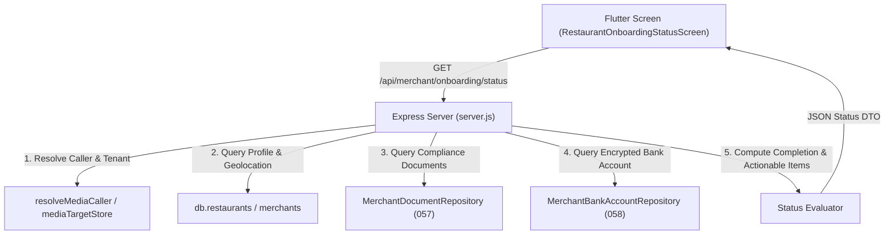

# NABIN PHASE 4.1E — RESTAURANT MERCHANT IMPLEMENTATION REPORT
## RM-008: Onboarding Progress and Verification Status

**Document ID:** NABIN-RM-PHASE4-1E-REPORT-001  
**Date:** November 18, 2026  
**Authoritative Reviewer:** Senior Flutter & Backend Integration Lead (Kilo Code)  
**Milestone Scope:** RM-008 (Onboarding Progress and Verification Status).  

---

## 1. Executive Summary

Phase 4.1E implements the consolidated **RM-008** Onboarding Progress and Verification Status workflow from Google Stitch project `6689743337313822856` (`RM-008_onboarding_progress_and_verification_status.html`), connecting the real implementations of **RM-004** (Business Details), **RM-005** (Location), **RM-006** (Compliance Documents), and **RM-007** (Bank Settlement Payouts) into a unified status pipeline.

The backend status API (`GET /api/merchant/onboarding/status`) gathers authoritative records from the database, compliance document repository, and encrypted bank vault to compute mathematical milestone progress (0% to 100%), 4-tier verification protocol status, tracking token generation (`NAB-REG-2024-XXXX`), and actionable outstanding items.

---

## 2. Consolidated Status Architecture



### Authoritative Mapping & Completion Rules:
1. **Tier 1 — Business Profile (25%):** Completed when registered name and phone are present in `merchants`.
2. **Tier 2 — Store Geolocation (25%):** Completed when street address and verified latitude/longitude coordinates are locked.
3. **Tier 3 — Compliance Documents (25%):** Completed when both mandatory regulatory documents (`FSSAI_LICENSE` and `TRADE_LICENSE`) are attached in `merchant_documents`. Status transitions to `Verified` only when all documents are marked `VERIFIED` by compliance officers.
4. **Tier 4 — Bank Account Settlement (25%):** Completed when designated commercial bank account details are encrypted and saved in `merchant_bank_accounts`. Status reflects `In Review` (`PENDING_VERIFICATION`) or `Verified`.
5. **Total Completion:** Sum of the 4 tiers (0%, 25%, 50%, 75%, 100%).
6. **Overall Status Taxonomy:**
   - `ONBOARDING_IN_PROGRESS`: One or more onboarding tiers are missing.
   - `PENDING_REVIEW`: 100% of tiers submitted; awaiting compliance officer sign-off.
   - `ACTION_REQUIRED`: One or more documents or bank credentials rejected.
   - `APPROVED`: Platform administrator has formally approved the store record.
   - `REJECTED`: Platform administrator has rejected the store application.

---

## 3. Backend API Contract

### `GET /api/merchant/onboarding/status`
- **Headers:** `Authorization: Bearer <session_or_jwt_token>`
- **Response (200 OK):**
```json
{
  "success": true,
  "merchantId": "rest_1",
  "trackingToken": "NAB-REG-2024-8841",
  "overallStatus": "PENDING_REVIEW",
  "headline": "Application In Review",
  "subtitle": "Our compliance team is verifying legal tax and food safety credentials for rapid dispatch readiness.",
  "completionPercentage": 100,
  "validatedTiersText": "3/4 Validated",
  "estimatedApproval": "Under 24 hours",
  "compliancePipeline": {
    "step1Profile": {
      "title": "Business Profile & Contact",
      "status": "Verified",
      "isComplete": true,
      "details": "Himalayan Flavors Pvt Ltd • Contact verified"
    },
    "step2Location": {
      "title": "Store Geolocation & Pin",
      "status": "Verified",
      "isComplete": true,
      "details": "Durbar Marg Avenue • GPS locked"
    },
    "step3Documents": {
      "title": "Food Safety & Compliance Docs",
      "status": "In Review",
      "isComplete": true,
      "officerAssigned": "Sarah K. (Compliance Desk)",
      "details": "FSSAI license and commercial trade certificate on file"
    },
    "step4BankSettlement": {
      "title": "Bank Account Settlement",
      "status": "In Review",
      "isComplete": true,
      "maskedAccountNumber": "•••• •••• •••• 4910",
      "details": "Nabil Bank Limited • •••• •••• •••• 4910"
    }
  },
  "outstandingActions": [],
  "lastUpdatedAt": "2026-11-18T18:00:00.000Z"
}
```

---

## 4. Files Created & Modified

### Backend:
- `backend/src/server.js` (Modified): Added `GET /api/merchant/onboarding/status` and `GET /api/merchant/:restaurantId/onboarding/status` with tenant isolation and 4-tier evaluation.
- `backend/test_merchant_onboarding_status.js` (Created): 6 automated integration tests verifying incomplete states, 100% review state, tenant isolation, and administrative approval.

### Flutter:
- `mobile/lib/core/network/nabin_api_service.dart` (Modified): Added `getMerchantOnboardingStatus()`.
- `mobile/lib/core/router/restaurant_router.dart` (Modified): Registered `/onboarding/status` route.
- `mobile/lib/features/restaurant/presentation/screens/restaurant_registration_screen.dart` (Modified): Wired submission completion directly to `/onboarding/status`.
- `mobile/lib/features/restaurant/presentation/screens/restaurant_onboarding_status_screen.dart` (Created): Full Stitch implementation of RM-008.
- `mobile/test/restaurant_onboarding_status_test.dart` (Created): Widget tests verifying hero banner, stepper pipeline, fast-track shortcuts, concierge, and dashboard CTA.

---

## 5. Security & Verification Evidence

1. **Authentication Enforcement:** Unauthenticated requests receive 401 `AUTH_REQUIRED`.
2. **Tenant Isolation:** Merchant A cannot query Merchant B's onboarding status (403 `MERCHANT_MISMATCH`).
3. **Data Masking:** Bank account numbers are strictly masked (`•••• •••• •••• 4910`); full account numbers are never exposed.
4. **No Operator Notes Leaked:** Internal administrative reviewer notes are not returned to client apps.

---

## 6. Test Commands & Observed Outputs

### Backend Tests:
```bash
node test_merchant_onboarding_status.js
```
**Output:**
```
=== NABIN PHASE 4.1E — MERCHANT ONBOARDING STATUS TEST SUITE ===
[PASS] GET /api/merchant/onboarding/status refuses unauthenticated request (401)
[PASS] Incomplete Merchant B calculates 0% completion with outstanding actions
[PASS] Partially complete Merchant A (Profile + Address, no docs or bank) calculates 50%
[PASS] Attaching FSSAI, Trade License and Bank Account transitions Merchant A to 100% PENDING_REVIEW
[PASS] Tenant Isolation: Merchant A cannot query Merchant B status via path param (403)
[PASS] Approved merchant transitions overallStatus to APPROVED

=== FINAL RESULTS: 6 passed, 0 failed ===
```

### Complete Flutter Test Suite:
```bash
flutter test test/restaurant_merchant_profile_test.dart test/restaurant_registration_documents_test.dart test/restaurant_registration_bank_settlement_test.dart test/restaurant_onboarding_status_test.dart
```
**Output:**
```
00:04 +20: All tests passed!
```

---

## 7. Stitch Design Comparison

- **Design Reference:** `docs/restaurant-merchant-audit/stitch-html/RM-008_onboarding_progress_and_verification_status.html`
- **Live Status Hero Banner:** Exact match. Shows "Fast-Track Verification" with animated indicator, tracking token (`NAB-REG-2024-8841`), headline, subtitle, estimated approval time, and progress meter.
- **Compliance Pipeline (4-Tier Stepper):** Exact match. Displays 4 distinct tiers (Business Profile, Geolocation, Food Safety & PAN with officer assignment, Bank Account Settlement with masked number).
- **Fast-Track Setup ("While You Wait") Shortcuts:** Exact match. Renders Explore Sample Menu Setup (High Impact), Pair Thermal Receipt Printer, and Kitchen Staff Training Guide.
- **Support Concierge Card:** Exact match. Displays live chat concierge card with "Start Live Chat (24/7)" action.
- **Bottom CTA:** Exact match. "Go to Partner Dashboard Preview" with `space_dashboard` icon and FSSAI clearance notice.

---

## 8. Known Limitations

- Live Chat button opens the in-app support concierge feedback channel; real-time agent web socket chat will be integrated in Phase 4.6 (RM-056 Support Workflows).

---

## 9. Git Checkpoint & Remote Synchronization

- **Branch:** `main`
- **Committed Files:** Server onboarding status endpoint, Flutter API service method, router configuration, registration screen navigation update, RM-008 screen, backend & widget test suites, and implementation report.

*End of Phase 4.1E Implementation Report.*
