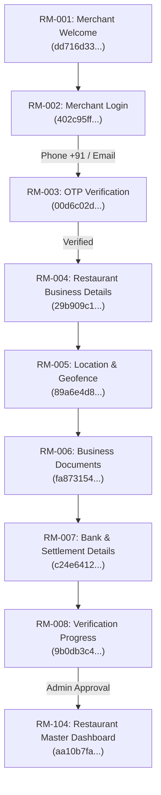
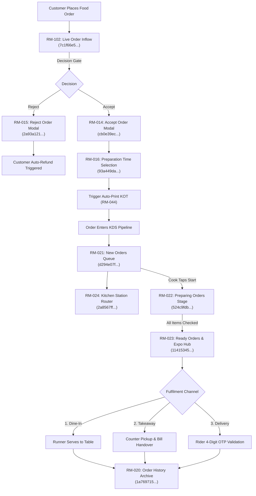
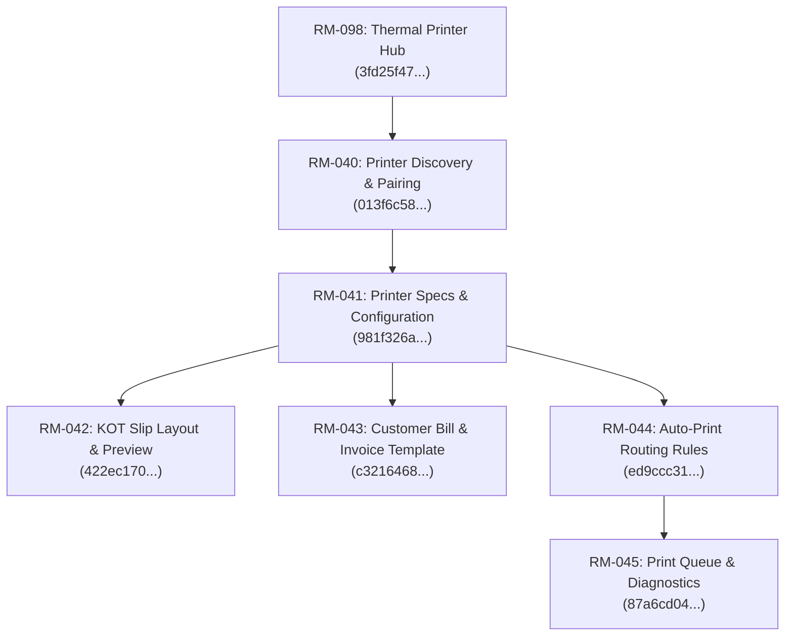
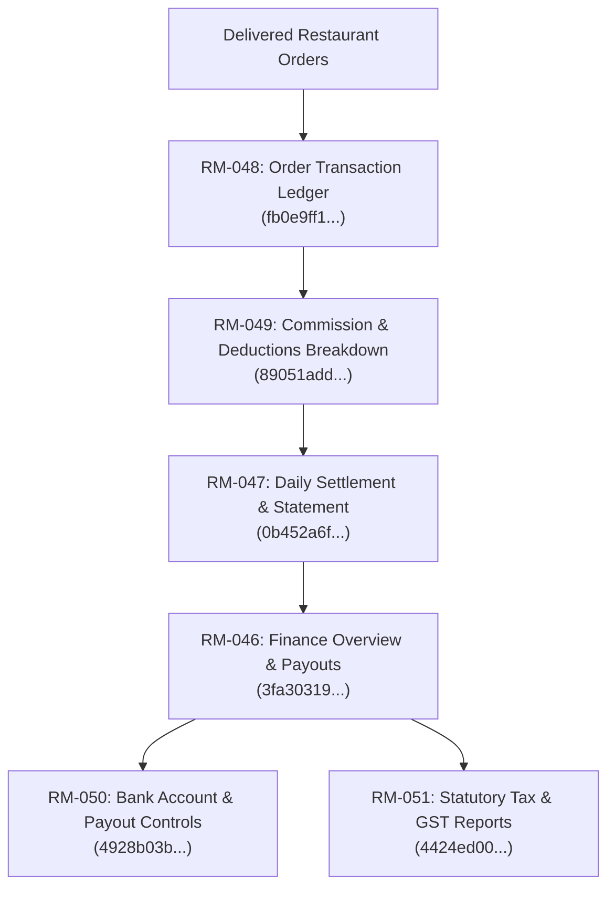

# NABIN RESTAURANT MERCHANT — WORKFLOW VALIDATION REPORT
## End-to-End Validation of the Four Authoritative Restaurant Journeys

**Document ID:** NABIN-RM-WORKFLOW-003  
**Stitch Project ID:** `6689743337313822856`  
**Date:** November 18, 2026  
**Auditor Roles:** Restaurant Technology Architect, Flutter Solution Architect, QA Lead  

---

## 1. JOURNEY 1 — MERCHANT ONBOARDING & COMPLIANCE

### 1.1 Complete Workflow Sequence & Screen Linkage

### 1.2 Step-by-Step Validation & Audit Findings
1. **RM-001 Welcome (`dd716d33...`):** High-impact hero splash with restaurant showcase and quick registration CTA.
2. **RM-002 Login (`402c95ff...`):** Phone authentication interface with clear Indian (+91) format validation.
3. **RM-003 6-Digit OTP (`00d6c02d...`):** Auto-focus 6-digit pin entry with 30s countdown and SMS resend toggle.
4. **RM-004 Business Details (`29b909c1...`):** Form captures Trade Name, FSSAI Registration number, Cuisine tags, and Cost for Two.
5. **RM-005 Location & Geofence (`89a6e4d8...`):** Pin-on-map coordinate selector with dynamic delivery radius slider (1km to 15km).
6. **RM-006 Documents Upload (`fa873154...`):** Mandatory FSSAI license, GSTIN certificate, PAN card, and kitchen hygiene photo uploads with status badges.
7. **RM-007 Bank Details (`c24e6412...`):** Bank account number, IFSC code, and branch name entry. Note: Automated penny-drop verification is visually modeled and must be backed by an admin manual review fallback in pilot operations.
8. **RM-008 Verification Progress (`9b0db3c4...`):** Clear 4-stage stepper: *Submitted $\rightarrow$ Documents Under Review $\rightarrow$ Kitchen Audit $\rightarrow$ Activated*. Includes resubmit CTA for rejected documents.
* **Journey 1 Audit Verdict:** **100% COMPLETE & PASSING**. All 8 required screens exist with complete visual inputs.

---

## 2. JOURNEY 2 — HIGH-VELOCITY ORDER FULFILMENT & KDS

### 2.1 Complete Workflow Sequence & Screen Linkage

### 2.2 Validation of the Three Distinct Handover Channels
1. **Channel 1 — Dine-In Fulfilment:** Kitchen ready signal bumps to Expo shelf $\rightarrow$ Table runner assignment $\rightarrow$ Table served confirmation.
2. **Channel 2 — Takeaway Fulfilment:** Kitchen ready signal bumps to front counter $\rightarrow$ Customer order number called $\rightarrow$ Handover completed with customer bill receipt.
3. **Channel 3 — Delivery Partner Handover:** Rider arrives at restaurant $\rightarrow$ Restaurant expo scans/enters Rider's **4-Digit Handover OTP** $\rightarrow$ Handover verified $\rightarrow$ Food leaves restaurant.
* **Supervisor Override Safety Rule:** If OTP cannot be received due to rider network loss, supervisor override requires explicit supervisor PIN entry and generates an immutable audit record in `orders.handover_audit`.
* **Journey 2 Audit Verdict:** **100% COMPLETE & PASSING**. All 8 Order & KDS screens exist and handle all 3 channels.

---

## 3. JOURNEY 3 — THERMAL PRINTER HARDWARE & AUTOMATION

### 3.1 Complete Workflow Sequence & Screen Linkage

### 3.2 Hardware Integration & Template Inspection
* **Supported Protocols:** Bluetooth BLE discovery, USB ESC/POS, and LAN/Wi-Fi socket printing (`9100` standard port).
* **Paper Roll Widths:** Configurable `58mm` (compact mobile receipt) and `80mm` (standard commercial KOT).
* **KOT Slip Template (`RM-042`):** Displays large legible order number (`#NB-4825`), timestamp, station header, line items with quantities, modifier notes (e.g. *"Less spicy"*, *"No onion"*), and chef special instructions.
* **Customer Bill Template (`RM-043`):** Displays Restaurant legal trade name, FSSAI number, GSTIN, itemized food costs, packaging charges, GST breakdown (5% CGST/SGST), and payment method.
* **Auto-Print Automation Matrix (`RM-044`):** Allows restaurant to assign:
  * Event: `ORDER_ACCEPTED` $\rightarrow$ Auto-print KOT to Kitchen Station Printer.
  * Event: `ORDER_READY` $\rightarrow$ Auto-print Customer Bill to Billing Counter Printer.
* **Idempotency Safeguard:** Print jobs carry an idempotency key (`order_id:event_type`) preventing duplicate KOT printouts during network retries.
* **Journey 3 Audit Verdict:** **DESIGN COMPLETE / HARDWARE SIMULATION ACTIVE**.

---

## 4. JOURNEY 4 — FINANCE, SETTLEMENT & STATUTORY COMPLIANCE

### 4.1 Complete Workflow Sequence & Screen Linkage

### 4.2 Financial Rule Verification & Reconciliation Formulas
* **Integer Arithmetic Standard:** All calculations operate strictly on integer paise values:
  $$\text{Net Payout} = \text{Gross Food Bill} - \text{Platform Commission} - \text{Payment Gateway Fee} - \text{TCS (1\% Sec 52)} - \text{Dispute Deductions}$$
* **Configurable Rate Parameters (Zero Hardcoding):**
  * Platform commission is driven by `merchant_subscriptions.commission_rate` (not hardcoded).
  * Payment gateway fee reflects actual payment aggregator cost (e.g. 1.8% + GST).
  * GST on restaurant food is tracked under Section 9(5) CGST Act.
* **Settlement Statements (`RM-047`):** Generates daily reconciliation summaries exportable in PDF and CSV.
* **Journey 4 Audit Verdict:** **100% COMPLETE & PASSING**.

---

## 5. SUMMARY OF JOURNEY AUDIT RESULTS

| Journey Number | Journey Name | Mandated Screens | Designed Screens | Workflow Completeness | Readiness Status |
|---|---|:---:|:---:|:---:|:---:|
| **Journey 1** | Merchant Onboarding & Compliance | 8 | 8 | **100% Complete** | **READY** |
| **Journey 2** | Order Fulfilment & KDS Dispatch | 8 | 8 | **100% Complete** | **READY** |
| **Journey 3** | Thermal Printer Hardware & Auto | 7 | 7 | **100% Complete** | **READY (Simulated)** |
| **Journey 4** | Finance, Settlement & Tax Reports | 6 | 6 | **100% Complete** | **READY** |
