# NABIN — FINAL IMPLEMENTATION PLAN & STATUTORY HARMONIZATION

**Document ID:** NABIN-FINAL-PLAN-003  
**Date:** November 17, 2026  
**Status:** **FINAL SPECIFICATION (AWAITING OWNER AUTHORIZATION FOR PHASE 12)**  
**Authoritative References:** MoRTH MVAG 2025 • CGST Section 9(5) & April 2025 Specified Premises Framework • CBIC HSN Schedule • Zero Stitch Modification  

---

## 1. Zero Modification & Screen ID Preservation Confirmation

1. **Stitch Cloud Preservation Audit:**
   - **Verification:** All **176 pre-existing instances** (137 UI screens, 7 technical markdown specifications, 32 brand/system assets) across all five Google Stitch projects remain **100% untouched and unmodified**.
   - No screen in Stitch has been deleted, overwritten, renamed, or moved during any audit or planning turn.
2. **Original Screen ID Immutability:**
   - Every original screen ID (e.g. `6404eca20f12433bad74944b71b6c8f4` for Super-App Home, `512117cb16164a56beb457a7d7a99024` for Ride Home) remains immutable.
3. **Dedicated New IDs for Proposed Additions:**
   - The four proposed gap additions are assigned distinct, non-conflicting identifiers that do not collide with any existing screen:
     - `SA-GAP-01` (Super-App Landmark Validation Guard)
     - `RD-GAP-01` (Ride Multi-Stop Waypoints Selector)
     - `FD-GAP-01` (Food Statutory Tax & Fee Modal)
     - `GR-GAP-01` (Grocery HSN Multi-Slab Tax & Delta Ledger)

---

## 2. Updated Regulatory Harmonization & Verified Tax Treatment

### A. Ride Regulatory Framework: Motor Vehicle Aggregator Guidelines 2025
- **Reference:** Ministry of Road Transport and Highways (MoRTH) **Motor Vehicle Aggregator Guidelines 2025 (MVAG 2025)** and applicable State Transport Department rules (e.g., Mizoram Motor Vehicle Aggregator Rules / Local Regional Transport Authority guidelines).
- **Core Principles under MVAG 2025:**
  - **Base Fare:** Must not be priced below the state/city-notified minimum fare for respective vehicle classes (2-Wheeler Bike Taxi, 3-Wheeler Auto-Rickshaw, 4-Wheeler Taxi/Cab).
  - **Dynamic Pricing (Surge):** Governed by state regulatory caps (under MVAG 2025, default upper dynamic multiplier ceiling is capped as notified by state authorities, with a minimum floor to protect driver earnings).
  - **Waiting Charges & Stop Fees:** MVAG 2025 requires transparency on stops and dead mileage. Intermediate stop charges and waiting rates are **dynamic parameters configured via the City Rate Card database** (`city_rate_cards`), validated against local RTO notifications.
  - **Driver SOS & Telemetry:** 24x7 control room integration with emergency service 112 and real-time trip route sharing are statutory safety requirements under MVAG 2025.

---

### B. Food GST: Section 9(5) & April 2025 "Specified Premises" Framework
- **Statutory Framework:** Section 9(5) of the Central Goods and Services Tax (CGST) Act, 2017 read with Notification No. 17/2021-Central Tax (Rate) and updated amendments effective **April 1, 2025**.
- **The "Specified Premises" Distinction:**
  - **General Restaurant Services:** Where cooked meals are supplied through an Electronic Commerce Operator (ECO / NABIN) by standalone restaurants or cloud kitchens, the ECO is strictly liable to discharge **5% GST** (2.5% CGST + 2.5% SGST) with zero Input Tax Credit (ITC).
  - **Specified Premises (Effective April 2025):** Where restaurant services are provided at premises providing hotel accommodation having declared tariff / published tariff of any unit of accommodation of **₹7,500 per day or above** (or as revised under the April 2025 threshold rules), the supply is classified as accommodation-linked restaurant services attracting **18% GST with ITC**.
  - **Platform Implementation:** The database schema tracks `merchants.is_specified_premises` (boolean). Standalone cloud kitchens and town diners default to 5% Section 9(5) ECO liability; certified hotel premises trigger the 18% tier.
- **Ancillary Charges Treatment:**
  - **Restaurant Packaging:** Treated as composite supply under Section 8(a) of the CGST Act, adopting the principal food supply tax rate (5% or 18%).
  - **Platform Convenience Fee:** 18% GST (SAC 9985) as pure platform technology consideration.
  - **Delivery Partner Fee:** Discharged per marketplace model and partner registration status.
  - **Voluntary Tips:** 100% pass-through to rider; zero tax.

---

### C. Grocery GST: HSN-Based Dynamic Catalogue & Effective Notifications
- **Statutory Framework:** Customs Tariff Act, 1975 HSN Chapter Codes read with CBIC Notifications No. 01/2017-Central Tax (Rate), No. 06/2022, No. 07/2022, and subsequent GST Council clarifications.
- **HSN Classification Principles:**
  - **Nil-Rated / 0% GST:** Fresh vegetables, fruits, unpackaged/loose food grains, unbranded pulses, unpasteurized milk (e.g., HSN 0701, 1006 loose).
  - **5% GST Slab:** Pre-packaged and labelled food grains, pulses, flour ($\le 25$ kg), edible cooking oils, tea leaves (e.g., HSN 1006 packaged, HSN 1507).
  - **12% GST Slab:** Processed foods, butter, cheese, dairy spreads, fruit juices in retail cartons (e.g., HSN 0405, 2009).
  - **18% GST Slab:** Soaps, surface cleaners, toothpastes, hair oils, household detergents (e.g., HSN 3401, 3402, 3306).
  - **28% GST Slab + Compensation Cess:** Aerated sugar-sweetened beverages, energy drinks (e.g., HSN 2202).
- **Picking Replacement Delta:** When a customer approves a substitute item, the price differential $\Delta_{\text{price}}$ is computed and itemized in real time. Negative deltas trigger automatic wallet credits; positive deltas prompt an instant payment adjustment.

---

## 3. Comprehensive Configurable Parameters Register

To prevent hardcoded rigidity and respect local city operational differences, **all business variables are established as configurable database parameters**:

| Parameter Key | Parameter Purpose | Default / Reference Value | Configuration Level |
|---|---|---|---|
| `landmark_min_char_length` | Minimum string length for landmark prompt | `4` characters | Platform Global |
| `landmark_allow_call_override`| Allow user to skip landmark with "guide via call" | `true` | Platform Global |
| `ride_max_intermediate_stops` | Maximum intermediate waypoints allowed | `2` stops | City Rate Card |
| `ride_intermediate_stop_fee` | Charge per intermediate waypoint | `₹25.00` *(Configurable)* | City Rate Card |
| `ride_free_waiting_window_sec`| Free curbside waiting window at stops | `180` seconds (3 min) | City Rate Card |
| `ride_waiting_charge_per_min` | Waiting rate after free window | `₹2.50` / min *(Configurable)*| City Rate Card |
| `ride_surge_max_ceiling` | Maximum dynamic surge multiplier | `1.5x` *(State Capped)* | City Rate Card |
| `food_section_9_5_rate` | Standard restaurant cooked meal GST | `0.05` (5%) | Statutory Tax Engine |
| `food_specified_premises_rate`| Specified hotel premises restaurant GST | `0.18` (18%) | Statutory Tax Engine |
| `platform_convenience_fee_rate`| GST on platform technology fee | `0.18` (18%) | Statutory Tax Engine |
| `grocery_cod_city_order_cap` | Maximum cash-on-delivery limit per order | `₹1,500.00` *(Configurable)* | City Operational Policy |

---

## 4. UI Design & Screen Connection Register for the 4 Additions

```mermaid
flowchart TD
    subgraph SuperApp_489536988828642080 [Customer Super-App]
        NABIN_016["NABIN-016 Location Setup"] --> SA_GAP_01["SA-GAP-01: Landmark Validation & Correction Guard"]
        NABIN_018["NABIN-018 Pin Confirmation"] --> SA_GAP_01
        SA_GAP_01 --> NABIN_021["NABIN-021 Main Home"]
    end

    subgraph Ride_15895521349027986707 [NABIN Ride]
        RIDE_002["RIDE-002 Location Search"] --> RD_GAP_01["RD-GAP-01: Multi-Stop Waypoints Selector"]
        RD_GAP_01 --> RIDE_003["RIDE-003 Map Pin Confirm"]
        RD_GAP_01 --> RIDE_004["RIDE-004 Category Fare Compare"]
    end

    subgraph Food_7613683360643688164 [NABIN Food]
        FOOD_009["FOOD-009 Food Cart"] <--> FD_GAP_01["FD-GAP-01: Section 9(5) Statutory Tax Modal"]
        FOOD_013["FOOD-013 Checkout Review"] <--> FD_GAP_01
    end

    subgraph Grocery_7916514387823717414 [NABIN Grocery]
        GROCERY_018["GROCERY-018 Checkout Review"] --> GR_GAP_01["GR-GAP-01: HSN Multi-Slab Invoice & Delta Ledger"]
        GROCERY_026["GROCERY-026 Order Delivered"] --> GR_GAP_01
    end
```

### Proposed Additions & Connection Verification:
1. **`SA-GAP-01` (Super-App Landmark Validation Guard):**
   - *Design:* Soft warning bottom sheet (`#FEF3C7`), Royal Blue outline input (`#1A3BA2`), landmark chips (*"Near SBI ATM"*, *"Near Market"*), and an accessible *"Deliver without landmark — I'll guide via call/chat"* override button.
   - *Connections:* Connects from `NABIN-016` (Location Setup) and `NABIN-018` (Pin Confirmation) into `NABIN-021` (Main Home).
2. **`RD-GAP-01` (Ride Multi-Stop Waypoints Selector):**
   - *Design:* Vertical waypoint timeline (Pickup, Stop 1 & Stop 2 amber dots, Drop pin), intermediate arrival ETA preview, and notice pill: *"Free 3-min wait per stop; standard city waiting rate thereafter"*.
   - *Connections:* Connects from `RIDE-002` (Location Search) into `RIDE-003` (Pin Confirmation) and `RIDE-004` (Category Fare Compare).
3. **`FD-GAP-01` (Section 9(5) Statutory Food Tax & Fee Modal):**
   - *Design:* White bottom sheet with itemized sections: Restaurant Food GST (cites *"Section 9(5) Govt. Tax"*), Packaging Composite Charge, Platform & Delivery 18% GST, and Voluntary Rider Tip (0% GST). Reads `merchants.is_specified_premises` flag dynamically.
   - *Connections:* Connects as an interactive modal from `FOOD-009` (Food Cart) and `FOOD-013` (Checkout Review).
4. **`GR-GAP-01` (HSN Multi-Slab Grocery Tax & Delta Ledger):**
   - *Design:* GSTR-1 compliant invoice ledger grouping items by HSN code (`0%`, `5%`, `12%`, `18%`), plus an explicit substitution delta box highlighting wallet credit or extra charge when an item is replaced.
   - *Connections:* Connects from `GROCERY-018` (Checkout Review) and `GROCERY-026` (Order Delivered & Tax Invoice).

---

## 5. Implementation Execution Gate

Execution remains **stopped**. No changes will be executed in Google Stitch until your explicit authorization is received.
All 176 pre-existing instances remain completely intact and original screen IDs are strictly preserved.
